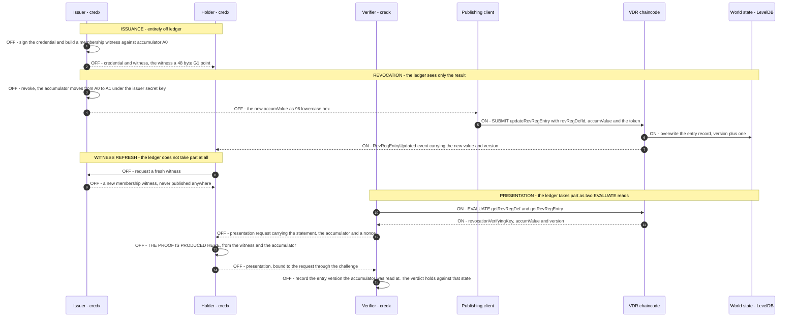
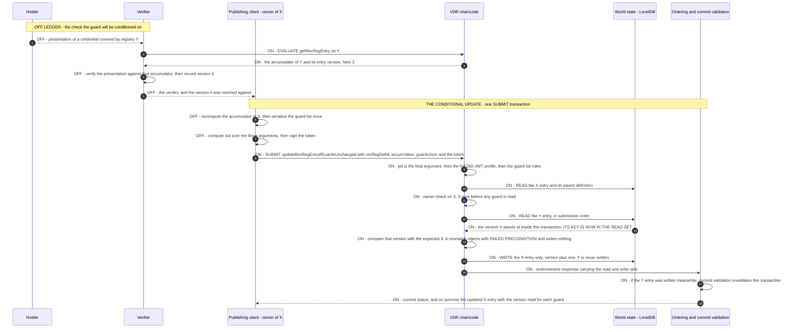

# Hyperledger Fabric AnonCreds Method

**Specification Status:** Editor's Draft

| | |
|---|---|
| **Version** | 0.3.0 |
| **Date** | 2026-09-22 |
| **Verifiable Data Registry** | A Hyperledger Fabric channel running the `VdrContract` chaincode |
| **AnonCreds object model** | AnonCreds v2 (see [§2](#2-status-of-this-document) — no normative v2 object data model exists; shapes are pinned to `credx`) |
| **Reference implementation** | [`fabric-vdr-core`](https://github.com/snktibor/fabric-vdr-core) |
| **Editors** | _To be completed before registry submission._ |
| **Repository** | This document lives at `docs/anoncreds-method.md` in the `anoncreds-vdr-demo` repository. |

> **Object shapes in this specification are pinned to `hyperledger/anoncreds-v2-rs`, crate `credx` version `0.2.1`, commit `691297a7f9ffcc1f51a5d30741086402d64544c9`.** Every encoding and every RECOMMENDED JSON shape below was produced by serializing that build's own structures, not transcribed from prose. See [§2.4](#24-what-this-specification-pins-instead).

---

## 1. Abstract

This document specifies an AnonCreds objects method for a Hyperledger Fabric verifiable data registry. It defines how AnonCreds Schema, Credential Definition, Revocation Registry Definition and Revocation Registry Entry objects are identified, published to, and resolved from a Fabric channel running the `VdrContract` chaincode.

Object identifiers are DID URLs rooted at the publishing issuer's DID. Publication is authorized by a DID-JWT that is bound to the deployment, to the exact transaction being authorized, and to a single use. Revocation follows the tails-free VB20 pairing-based accumulator scheme as implemented by the AnonCreds v2 reference implementation: the registry publishes a single opaque accumulator value and no revocation bit-string, no status list, and no tails file.

This method deliberately draws a scope boundary that AnonCreds v1 methods did not have to draw. Under v1, non-revocation is provable from published registry state alone. Under the v2 accumulator scheme specified here, it is not: a holder must obtain a fresh membership witness from the issuer. That interaction is not a registry operation. This specification therefore specifies *discovery* of the issuer's refresh service and states explicitly that the refresh protocol itself is out of scope ([§9](#9-non-revocation-and-the-witness-refresh-boundary)).

---

## 2. Status of this document

### 2.1 This is an Editor's Draft

This document has not been submitted to the AnonCreds Methods Registry, has not been reviewed by the AnonCreds Specification Working Group, and carries no standing beyond that of an implementation report for the reference implementation it describes.

### 2.2 Two artifacts, not one

The AnonCreds Methods Registry entry and this method specification are separate artifacts. The registry entry is a short pointer record — name, status, VDR, contact details, and a link to a specification — and the registry's own template states that it "is not the specification itself, just an overview and context about the method". Two currently registered methods carry `Specification: To Be Added`.

This document is the method specification. A draft of the corresponding registry entry is provided in [Appendix A](#appendix-a--draft-registry-entry). Publishing this document in the registry's Spec-Up toolchain is a mechanical packaging step deferred until a registry pull request is opened.

### 2.3 The first AnonCreds v2 objects method

All eight methods currently in the AnonCreds Methods Registry describe AnonCreds v1 objects. A survey of the registry repository across all issues and pull requests found no discussion of v2, the registry entry template has no field in which to declare an object-model version, and the registry's introduction scopes itself to "AnonCreds objects as defined in the AnonCreds Specification", linking the v1 specification.

More consequentially, there is no normative AnonCreds v2 object data model to conform to:

| Evidence | Finding |
|---|---|
| `spec/anoncreds_methods.md` in the v2 specification | Byte-identical to the v1 chapter apart from five lines of URL updates that v1 received during the organisation move and v2 did not. It still describes the v1 object set, Indy-style deltas, and the "Revocation Status List". |
| `spec/appendix_data_models.md` (v2) | A literal `todo` stub. |
| `data_flow_*.md` (v2) | v1 has seven such files; v2 has none. |
| `spec/crypto.md` (v2) | Headings cover only "Issuer Setup" and CL-signature proving. No BBS, PS, or accumulator content. |
| `terminology.md` (v2) | Still defines Tails File, Revocation Status List and Witness Delta; carries a `TODO` for Non-Revocation Proof. |

A v1 method specification can write "the AnonCreds Schema object" and cite the specification. This one cannot. The object shapes have to be defined or pinned here.

### 2.4 What this specification pins instead

Object shapes are pinned to the AnonCreds v2 reference implementation, `hyperledger/anoncreds-v2-rs` (crate `credx`), version `0.2.1`, commit `691297a7f9ffcc1f51a5d30741086402d64544c9`. This is the only de-facto anchor available.

Pinning to an implementation rather than a specification is a deliberate, stated weakness of this document. It is chosen over the alternative — inventing shapes that no implementation produces — because it is verifiable: every encoding and every RECOMMENDED JSON shape in [§8](#8-anoncreds-objects) was obtained by serializing that build's structures with `serde_json` and is reproducible from the pinned commit. Where this specification names a `credx` type, field, or function, it refers to that commit.

If and when the AnonCreds Specification Working Group publishes a normative v2 object data model, the pinned shapes here should be re-evaluated against it, and this document's version changelog should record the outcome.

### 2.5 What is normative in this document

Normative are: the identifier grammar ([§7](#7-object-identifiers)); the authorization requirements ([§6](#6-issuer-identity-authorization-and-replay-protection)); the wire encodings of `accumValue` and `revocationVerifyingKey` ([§8.1](#81-object-data-model-wire-encodings-and-the-credx-pin)); the `IssuerPublic` reassembly requirements in [§8.1.5](#815-assembling-a-credx-issuerpublic-from-resolved-objects); and the numbered creation and resolution steps in [§8.3](#83-schema)–[§8.6](#86-revocation-registry-entry).

The `publicMetadata` shapes in [§8.1.6](#816-recommended-publicmetadata-shapes) are RECOMMENDED, not enforced. The chaincode validates only that `publicMetadata` is a JSON object. This gap is recorded as an open item in [§11.3](#113-crypto-material-in-unvalidated-metadata-code-gap).

---

## 3. Terminology and conventions

### 3.1 Requirement keywords

The key words MUST, MUST NOT, REQUIRED, SHALL, SHALL NOT, SHOULD, SHOULD NOT, RECOMMENDED, MAY and OPTIONAL in this document are to be interpreted as described in BCP 14 [RFC2119] [RFC8174] when, and only when, they appear in all capitals.

Requirements bind three roles, named explicitly wherever they appear:

- **Publisher** — the client submitting a transaction that writes an object.
- **Registry** — the `VdrContract` chaincode and the Fabric channel it runs on.
- **Resolver** — any client reading objects back, including verifiers and holders.

Where a requirement falls on the resolver because the registry does not enforce it, this document says so at that point rather than leaving it implied.

### 3.2 Terms

**Accumulator** — a single BLS12-381 G1 group element summarising the set of non-revoked credential identifiers. In this method it is the entirety of the published revocation state.

**Channel** — a Fabric ledger instance with its own world state, block store and membership. One channel is one deployment of this method.

**Chaincode** — the smart contract executing on Fabric peers. Here, `VdrContract`.

**credx** — the crate name of `hyperledger/anoncreds-v2-rs`, the AnonCreds v2 reference implementation.

**DID-JWT** — a compact JWT whose `iss` claim is a DID and whose signing key is resolved from that DID's document. This method's profile is in [§6.3](#63-did-jwt-profile).

**EVALUATE / SUBMIT** — Fabric transaction intents. EVALUATE is a read executed on a peer without ordering or commitment; SUBMIT is endorsed, ordered and committed, and may write state.

**Membership witness** (also *revocation handle*) — the holder-side value proving that a credential identifier is still in the accumulator. It is never published to the registry. `credx` calls the type `MembershipWitness` and the credential field `revocation_handle`.

**MVCC validation** — Fabric's read-set version check at commit time. Two transactions that read and write the same key concurrently cannot both commit.

**Object identifier** — a DID URL naming one published AnonCreds object; see [§7](#7-object-identifiers).

**VB20** — the pairing-based accumulator of Vitto and Biryukov (eprint 2020/777), implemented at `credx::knox::accumulator::vb20`.

**VDR** — verifiable data registry. Here, the Fabric channel plus the `VdrContract` chaincode.

**World state** — the current-value key-value store maintained by each peer, alongside a per-key revision history index.

---

## 4. Overview and scope

### 4.1 Goal

To publish and resolve AnonCreds v2 objects on a permissioned Hyperledger Fabric network, such that:

- every object identifier names its own issuer and cannot be minted by anyone else;
- every write is authorized by a key the issuer published, and cannot be replayed;
- the objects a verifier needs are resolvable by identifier without out-of-band coordination, with the explicit exception recorded in [§11.3](#113-crypto-material-in-unvalidated-metadata-code-gap);
- revocation state is a single accumulator value, with no tails file and no per-credential status bit.

### 4.2 Trust model

**Open DID registration.** `createDid` takes no DID-JWT. Any channel member MAY register any syntactically valid, not-yet-taken DID identifier, and ownership is self-assigned first come, first served: the DID document's `ownerId` is set to the DID itself. Every subsequent mutation is authorized against that self-registered ownership.

Because every AnonCreds object identifier is a DID URL rooted at its issuer's DID, registering a DID is also what reserves the identifier space beneath it. The consequences are discussed in [§10.7](#107-open-did-registration-and-identifier-space-squatting).

**Network membership is the outer gate.** The reference deployment defines a single organisation with no explicit endorsement policy, so the Fabric-level write gate is membership in that organisation. The chaincode reads no MSP attributes and makes no authorization decision on the transport identity. Application-level authorization is entirely the DID-JWT layer of [§6](#6-issuer-identity-authorization-and-replay-protection).

**Reads are unauthenticated.** All resolution transactions are EVALUATE reads that take no token. Any channel member can resolve any object.

### 4.3 Conformance to the AnonCreds specification's normative requirements

The AnonCreds specification imposes three requirements on an objects method. All three are addressed:

| Requirement | Where satisfied |
|---|---|
| Identifiers MUST be URIs conformant with [RFC3986] | [§7.2](#72-uri-conformance). Identifiers are DID URLs, which are RFC 3986 URIs. |
| The method MUST define the format of the issuer identifier | [§6.1](#61-issuer-identifiers). |
| The method MUST verify that the publisher of an object controls the issuer identifier before publishing | [§6.8](#68-verifying-publisher-control), enforced structurally per [§7.7](#77-issuer-control-by-construction). |

The specification's further guidance on revocation — that a method may normalise deltas or full state "to the RevReg format expected for AnonCreds generate presentation processing" — is not actionable here, because that target format is the v1 bit-string-plus-accumulator structure and no v2 equivalent has been published. See [§8.2](#82-deviations-from-anoncreds-v1-object-shapes).

### 4.4 Deviations stated up front

This method departs from the object shapes described in the AnonCreds specification's methods chapter in six ways: no tails files, no revocation bit-string, a revocation scheme token other than `CL_ACCUM`, a changed meaning for `maxCredNum`, a signature-scheme indicator on the credential definition, and G2 accumulator key material in place of `accumKey.z`. Each is stated in full in [§8.2](#82-deviations-from-anoncreds-v1-object-shapes) and restated at the object it affects.

### 4.5 Out of scope

- **The witness-refresh protocol.** Discovery of the refresh service is specified ([§9.4](#94-discovery-of-the-refresh-service)); the protocol itself is issuer-defined.
- **The DID method.** This method is DID-method-agnostic ([§6.2](#62-the-did-registry)). It does not define one. The `did:vdr` identifiers used in examples are a deployment convention with no published DID method specification; see [§11.6](#116-did-vdr-is-a-deployment-convention).
- **Credential issuance, presentation and proof formats.** Governed by the AnonCreds v2 protocol and its reference implementation.
- **Network operation.** Channel configuration, endorsement policy, and peer administration.

### 4.6 Universal AnonCreds resolver support

A universal AnonCreds resolver dispatches on the identifier. Because every identifier under this method is a DID URL whose DID part carries the method name, dispatch is the DID method name plus the `/anoncreds/v2/` path marker. A resolver that recognises the deployment's DID method and reaches a peer of the channel can resolve every object type through the EVALUATE transactions named in [§8](#8-anoncreds-objects). No additional resolution metadata is required.

---

## 5. The Hyperledger Fabric VDR

### 5.1 Channel, chaincode, world state

Objects are stored in the world state of a Fabric channel, written and read exclusively through the `VdrContract` chaincode. Each object type occupies its own composite-key namespace: `DID`, `SCHEMA`, `CREDDEF`, `REVREGDEF`, `REVREGENTRY`, and `JWTNONCE` for consumed token identifiers. Within a namespace the object identifier is the key.

The peers of the reference deployment run **LevelDB** as their state database, not CouchDB, and this method is written for that shape. Two consequences follow. First, there are no rich queries: every read this method performs is either a point lookup on a key or an ordered range scan over one composite-key namespace, which is why the `list*` transactions scan an entire namespace and why no transaction selects on record content. Second, the range reads it does perform are covered by Fabric's phantom-read protection — a range query enters the transaction's read set as a range plus a digest over the results it returned, and commit-time validation re-checks it, so a key inserted into that range between simulation and commit invalidates the transaction. A CouchDB rich query would carry no equivalent protection, because its result set is not re-evaluated at validation. The range-only access shape is therefore a property to preserve, not a limitation to route around.

### 5.2 SUBMIT and EVALUATE

Every publishing operation is a SUBMIT transaction: endorsed by peers, ordered, then committed. Every resolution operation is an EVALUATE transaction: executed against one peer's world state, unauthenticated, writing nothing.

This split has a consequence resolvers MUST account for: an EVALUATE read reflects the state of the peer that served it. A resolver reading immediately after a publish MAY observe the pre-commit state if it queries a peer that has not yet committed the block.

### 5.3 Endorsement, ordering and MVCC

A SUBMIT transaction's writes take effect only if the transaction passes endorsement and commit-time MVCC validation. Two concurrent transactions whose read sets overlap on a written key cannot both commit; the second fails validation and writes nothing. This is what serialises concurrent accumulator updates ([§8.6](#86-revocation-registry-entry)) and concurrent consumption of the same token identifier ([§6.6](#66-one-time-use)).

### 5.4 History index

Fabric maintains a per-key revision history. This method exposes it for one object type only: `getRevRegEntryHistory` returns every accumulator value ever written for a revocation registry definition, oldest first. This is how a verifier obtains the accumulator value that was current at a past point in time, which entry updates would otherwise overwrite.

### 5.5 Chaincode events

Every SUBMIT transaction emits exactly one event, delivered to subscribers with the committed block. A transaction that fails endorsement or validation delivers nothing, so an observed event always reflects committed state.

| Event | Emitted by | Payload |
|---|---|---|
| `DidCreated` / `DidUpdated` / `DidDeactivated` | the corresponding DID transaction | `{id}` |
| `SchemaCreated` | `createSchema` | `{id, issuerId}` |
| `CredDefCreated` | `createCredDef` | `{id, issuerId, schemaId}` |
| `RevRegDefCreated` | `createRevRegDef` | `{id, issuerId, credDefId}` |
| `RevRegEntryCreated` | `createRevRegEntry` | `{revRegDefId, accumValue, version}` |
| `RevRegEntryUpdated` | `updateRevRegEntry` **and** `updateRevRegEntryIfGuardsUnchanged` | `{revRegDefId, accumValue, version}` |

`RevRegEntryUpdated` is the event holders MUST watch: after every accumulator change a holder's membership witness is stale ([§9](#9-non-revocation-and-the-witness-refresh-boundary)). Its payload carries the new accumulator value so no follow-up query is needed. It deliberately carries no timestamp; see [§5.6](#56-time).

The two update transactions emit the **same** event with the **same** payload, deliberately. A subscriber refreshing witnesses cares that the accumulator moved, not which path moved it, and a second event name would leave every such subscriber blind to the registries that adopt the conditional path. That a conditional update's guards held is reported to its publisher in the transaction response, not broadcast ([§8.6](#86-revocation-registry-entry)).

### 5.6 Time

The only time value available to the chaincode is the submitting client's channel-header transaction timestamp. It is deterministic across peers — every peer computes the same value, which is what makes it usable at all — but it is chosen by the submitter and attested by neither the ordering service nor the peers.

This value is used for two purposes: evaluating DID-JWT time claims ([§6.3](#63-did-jwt-profile)), and stamping `createdAt` / `updatedAt` on records. It is audit metadata. Resolvers MUST NOT derive freshness or ordering guarantees from it; ordering within a revocation registry is what the entry `version` is for. See [§10.5](#105-timestamps-are-client-supplied-and-unattested).

---

## 6. Issuer identity, authorization, and replay protection

### 6.1 Issuer identifiers

The issuer identifier is a DID, conformant with the DID Core syntax:

```
did = "did:" method-name ":" method-specific-id
```

The registry enforces this syntax and nothing more. `method-name` is lowercase alphanumeric; `method-specific-id` is colon-separated groups of `idchar` (`ALPHA` / `DIGIT` / `.` / `-` / `_` / percent-encoded) ending in a non-empty group.

No DID method is privileged: `did:vdr`, `did:web` and `did:key` issuers are all syntactically legal. The check is not cosmetic — a DID contains no `/`, which is exactly what lets an object identifier split unambiguously into issuer DID and AnonCreds path at its first slash ([§7.1](#71-grammar)).

Issuer DIDs are registered on this same registry through `createDid` and MUST be `ACTIVE` at the time an object is published.

### 6.2 The DID registry

DID documents are stored in the `DID` namespace. Registration is open and unauthenticated ([§4.2](#42-trust-model)). The registry validates document shape:

- `verificationMethod` MUST contain at least one entry.
- Every entry MUST be a JSON object with non-empty textual `id`, `type` and `controller`.
- Every entry's `type` MUST be `JsonWebKey2020`.
- Every entry MUST carry a `publicKeyJwk` object with non-empty textual `kty`, `crv`, `x` and `y`, where `kty` is `EC` and `crv` is `P-256`.
- `service` is OPTIONAL. When present, every entry MUST be a JSON object. **No further validation is performed on service entries** — not `id`, not `type`, not `serviceEndpoint`. This matters in [§9.4](#94-discovery-of-the-refresh-service).

The requirement that *every* verification method be `JsonWebKey2020` / EC P-256, rather than merely the one selected by a token, is a restriction of the current implementation.

DID deactivation is irreversible and disables every JWT-gated operation of that issuer permanently, including accumulator updates on its revocation registries. See [§10.3](#103-key-control-and-irreversible-deactivation).

### 6.3 DID-JWT profile

Every state-changing transaction except `createDid` takes a compact DID-JWT as its final argument. Validation is fully ledger-local: no external network call is made, and all key material is resolved from world state.

A token MUST satisfy all of the following:

1. The JWT MUST have exactly three dot-separated segments, with base64url-decodable header and claims segments that each parse as a JSON object.
2. The header `alg` MUST be `ES256`.
3. The header `kid` MUST be present. A `kid` beginning with `#` is expanded by prefixing the `iss` value.
4. The claim `iss` MUST be a DID that exists in the DID registry and whose status is `ACTIVE`.
5. The `kid` MUST select a `verificationMethod` of that DID document whose `type` is `JsonWebKey2020` and which carries a `publicKeyJwk` object; that JWK MUST be `EC` / `P-256` with 32-byte `x` and `y` coordinates.
6. The signature MUST verify against the resolved key. Because the key was resolved from the document of the DID named in `iss`, a valid signature *is* the proof of issuance; the issuer is not re-checked separately.
7. `iat`, `nbf` and `exp` MUST all be present, and are evaluated against the transaction timestamp with a 30-second clock-skew tolerance. `iat` MUST NOT be more than the tolerance in the future. The system clock is not consulted.
8. `aud` MUST contain the deployment audience ([§6.4](#64-deployment-binding)).
9. The `txd` claim MUST match the transaction digest ([§6.5](#65-transaction-binding)).
10. `jti` MUST be present and MUST NOT have been consumed before ([§6.6](#66-one-time-use)).

Any failure produces an `UNAUTHORIZED` error and the transaction writes nothing.

### 6.4 Deployment binding

`aud` MUST contain the fixed string:

```
vdr-network:vdrchaincode
```

A token minted for another system, even one signed by the same DID key, is rejected.

### 6.5 Transaction binding

The `txd` claim binds a token to one specific invocation. It MUST equal:

```
base64url-no-pad( SHA-256( LP(method) || LP(arg₁) || … || LP(argₙ) ) )
```

where `LP(s)` is the 4-byte big-endian length of the UTF-8 encoding of `s`, followed by those bytes. `method` is the plain transaction method name with no contract-name prefix — for example `createSchema`. `arg₁…argₙ` are the transaction's string arguments in submission order, **excluding the trailing `jwt` argument itself**. Numeric parameters contribute the exact wire string the client submits, in canonical decimal.

Length-prefixing makes the digest input injective: no combination of method and argument values can collide with a different combination, regardless of argument content.

The registry recomputes this digest from the invocation it actually received, reading the submitted arguments from the transaction stub. It additionally enforces that the `jwt` is the final submitted argument, so the digest is always computed over exactly the non-JWT arguments the client submitted. A token minted for one operation, or for the same operation with different arguments, is rejected on any other.

**The conditional update.** `updateRevRegEntryIfGuardsUnchanged` ([§8.6](#86-revocation-registry-entry)) binds under the same formula, with `method` the literal string `updateRevRegEntryIfGuardsUnchanged` and `arg₁…arg₃` its three non-JWT arguments in submission order: `revRegDefId`, `accumValue`, `guardsJson`. Because the method name is the first element of the preimage, a token minted for `updateRevRegEntry` can never authorize the conditional path, and one minted for the conditional path can never authorize the unconditional one.

It is the first transaction of this method whose digest covers a structured payload, and the rule for it is stated here rather than left to be inferred. **`guardsJson` contributes the exact byte sequence the publisher submits.** This specification defines **no** canonical form for it: whitespace, the member order inside a guard object, and the order of the array's elements are all inside the digest, and neither the publisher nor the registry normalizes any of them before hashing. A publisher therefore MUST serialize the guard list **once** and MUST sign that same string, byte for byte, as the one it submits. A publisher that serializes the list a second time on its way to the wire — from the same structure, but with different spacing or a different member order — has signed a digest over a string it is not submitting, and every such transaction is rejected as `UNAUTHORIZED`.

### 6.6 One-time use

`jti` MUST be present and unique per issuer. On successful validation the registry derives a deterministic nonce key from the length-prefixed `(iss, jti)` pair — a SHA-256 hex digest, so no crafted issuer or `jti` value can collide with another pair — and writes a record into the `JWTNONCE` namespace together with the token's expiry.

If a record for that pair already exists the transaction is rejected as a replay. Because the absent-key read is part of the transaction's read set, Fabric MVCC validation serialises concurrent submissions of the same pair: only the first commits.

Replay protection therefore rests on `jti` consumption, not on token expiry. This is deliberate: the timestamp against which `exp` is evaluated is client-supplied ([§5.6](#56-time)), so a malicious client could otherwise back-date a transaction to re-enter a captured token's validity window.

### 6.7 Ownership

Every object record carries an `ownerId`, set at creation to the verified signer DID. Mutations are owner-gated: the signer DID MUST equal the recorded `ownerId`. Revocation registry entries carry no owner of their own; every authorization decision for an entry reads the `ownerId` of its parent revocation registry definition.

### 6.8 Verifying publisher control

The AnonCreds specification requires a method to verify that the publisher of an object controls the issuer identifier before publishing. This method satisfies that requirement with two checks applied on every object creation:

1. The object identifier MUST be a DID URL rooted at a syntactically well-formed issuer DID. No object-creating transaction declares an issuer separately: the identifier is the sole source, and the issuer is read back out of it at its first slash ([§7.7](#77-issuer-control-by-construction)).
2. The signer DID resolved from the verified token MUST equal that issuer DID. A mismatch is `UNAUTHORIZED`.

Together these mean a published identifier always names the DID that actually authorized it, and the proof is the ES256 signature over a transaction-bound, single-use token verified against a key that DID published.

---

## 7. Object identifiers

### 7.1 Grammar

Every AnonCreds object identifier is a **DID URL** rooted at the publishing issuer's DID:

```
<issuer-did> "/anoncreds/v2/" <TYPE> "/" <UUIDv7>
```

| Object type | Identifier format |
|---|---|
| Schema | `<issuer-did>/anoncreds/v2/SCHEMA/<UUIDv7>` |
| Credential definition | `<issuer-did>/anoncreds/v2/PUBLIC_CRED_DEF/<UUIDv7>` |
| Revocation registry definition | `<issuer-did>/anoncreds/v2/REV_REG_DEF/<UUIDv7>` |
| Revocation registry entry | none — addressed through its definition ([§7.6](#76-revocation-registry-entry-addressing)) |

This follows the convention every DID-bound registered method uses: `did:indy` writes `<did>/anoncreds/<version>/<TYPE>/<id>`, and the Hiero method writes `<publisher-did>/anoncreds/<version>/<TYPE>/<topic>`.

### 7.2 URI conformance

Identifiers under this method are DID URLs, and therefore URIs conformant with [RFC3986], satisfying the AnonCreds specification's sole identifier requirement.

They are **not URNs**. A URN has the form `urn:<nid>:<nss>` per [RFC8141] and requires a registered namespace identifier. Nothing in this method registers or uses a URN namespace, and this document uses the term "DID URL" throughout. No IANA action is required — consistent with the AnonCreds specification, whose IANA Considerations section reads in its entirety "This document has no IANA actions."

### 7.3 The version segment

The `v2` segment versions the AnonCreds **object shapes**, not this method specification. The two registered methods that encode object-family versioning sit at `v0` (`did:indy`, denoting legacy Indy-era shapes) and `v1` (Hiero). No registered method has populated a `v2`; this specification is the first to do so.

This document's own version is in the front matter and its changelog is [§13](#13-changelog). The two version numbers are independent and MUST NOT be conflated.

### 7.4 Type tokens

The `<TYPE>` segment MUST be one of `SCHEMA`, `PUBLIC_CRED_DEF`, or `REV_REG_DEF`.

`PUBLIC_CRED_DEF` is used in preference to the `CLAIM_DEF` token of `did:indy` for two reasons. `CLAIM_DEF` is Indy ledger transaction vocabulary for a CL-signature credential definition — an AnonCreds v1 construct this method rejects by construction, since the credential definition type allowlist admits only BBS and PS ([§8.2](#82-deviations-from-anoncreds-v1-object-shapes)). And `PUBLIC_CRED_DEF` states what is actually published: only the public half of the credential definition ever reaches the registry.

### 7.5 The object segment

The final segment MUST be a UUID version 7, matching:

```
^[0-9a-fA-F]{8}-[0-9a-fA-F]{4}-7[0-9a-fA-F]{3}-[89abAB][0-9a-fA-F]{3}-[0-9a-fA-F]{12}$
```

UUIDv7 carries an embedded millisecond Unix timestamp, so identifiers sort by creation time using the identifier alone, with no ledger lookup. Note that this timestamp is minted by the publishing client and carries the same trust caveat as every other client-supplied time value ([§5.6](#56-time)).

### 7.6 Revocation registry entry addressing

Revocation registry entries have **no identifier of their own**. Exactly one entry exists per revocation registry definition, so the definition's DID URL addresses its entry unambiguously, and the entry is stored under that key.

This mirrors how registered methods handle mutable revocation state. Hiero states that revocation registry entries "do not have an identifier and [are] discovered through associated RevRegDef object"; `did:web` notes that status lists "are not typically referenced by their ID but retrieved as the result of a query to the VDR for a given timestamp".

Registered methods that carry a pointer to the mutable state in the definition's metadata — Hiero's `hcsMetadata.entriesTopicId`, `did:web`'s `resourceMetadata.revocationStatusListEndpoint` — need one because the state lives elsewhere. Here it does not: the entry is keyed by the definition's own identifier, so the pointer is degenerate and no metadata field carries it.

The time dimension those methods encode in an entry identifier or query parameter is served here by `getRevRegEntryHistory` ([§8.6](#86-revocation-registry-entry)).

### 7.7 Issuer control by construction

Because the issuer DID is embedded in and roots the object identifier, the publisher-controls-issuer requirement is satisfied structurally rather than by a separate mechanism.

Object-creating transactions take no separate issuer argument. The identifier is *the sole source of the issuer*: a DID never contains `/` (DID Core), so the identifier splits unambiguously at its first slash, the segment before it must itself be a well-formed DID, and that issuer must in turn equal the verified token signer ([§6.8](#68-verifying-publisher-control)). No caller can mint an identifier rooted at a DID it does not control, and no resolver needs a second lookup to learn who published an object: the identifier names its own issuer.

The `issuerId` field on a resolved record is therefore derived, not declared. It is written at creation from the identifier the transaction carried, and a resolver that re-derives it from the identifier MUST obtain the same value.

This property is free for DID-bound methods and is the principal reason this method is DID-bound. A method whose identifiers carry no issuer binding must answer "how does a resolver know the publisher controlled `issuerId`?" with an explicit mechanism; here the answer is the grammar.

### 7.8 Identifiers are client-minted

The registry validates identifier grammar on creation and never generates an identifier. A publisher chooses the UUIDv7 itself. The registry rejects a duplicate identifier within a namespace, so minting is first-come, first-served within the space a DID's owner already controls.

### 7.9 Comparison with registered methods

| Method | Identifier shape | DID-bound |
|---|---|---|
| `did:indy` | `<did>/anoncreds/v0/<TYPE>/<id>` | yes |
| Hiero | `<publisher-did>/anoncreds/v1/<TYPE>/<topic-id>` | yes |
| `did:web` | `<did>?service=<svc>&relativeRef=/<path>/<object-id>` | yes |
| `did:prism`, cheqd, Cardano | DID URLs / DID-Linked Resources | yes |
| Legacy Indy | bare colon-delimited strings (the grandfathered non-URI exception) | no |
| HTTP | plain HTTP URLs | no |
| **This method** | `<issuer-did>/anoncreds/v2/<TYPE>/<UUIDv7>` | yes |

---

## 8. AnonCreds objects

### 8.1 Object data model, wire encodings, and the credx pin

#### 8.1.1 Encoding principle

For both cryptographic values this method publishes, **the normative layer is the compressed byte encoding.** Lowercase hexadecimal is this method's textual projection of those bytes, chosen because it is exactly what the pinned `credx` build's own `serde` serialization produces, so a `credx` client consumes the value directly with no adapter.

A future revision MAY define an additional textual projection of the same bytes. It MUST NOT change the bytes.

#### 8.1.2 `accumValue` — the VB20 accumulator

The accumulator is a **BLS12-381 G1 point**. On the wire and on the ledger it is the 48-byte ZCash-format compressed encoding — big-endian x-coordinate, with flag bits in the most significant byte (`0x80` compressed, `0x40` infinity, `0x20` y-sign) — written as **exactly 96 lowercase hexadecimal characters**:

```
^[0-9a-f]{96}$
```

This is byte-identical to what `credx` produces for `vb20::Accumulator`. Verified against the pinned commit: serializing an `IssuerPublic`'s `revocation_registry` field with `serde_json` yields a bare JSON string of exactly 96 lowercase hex characters.

#### 8.1.3 `revocationVerifyingKey` — the VB20 verifying key

The accumulator verifying key is a **BLS12-381 G2 point**: the 96-byte compressed encoding written as **exactly 192 lowercase hexadecimal characters**:

```
^[0-9a-f]{192}$
```

This is `credx`'s `IssuerPublic.revocation_verifying_key` (`vb20::PublicKey`), which likewise serializes as a bare 192-character lowercase hex JSON string.

#### 8.1.4 Validation scope

On-chain validation of both values is **format-only**: length, lowercase-hex charset, the compression flag must be set, and the identity element (infinity flag set) is rejected outright — neither an accumulator nor a verifying key is ever legitimately the identity.

Uppercase hex, `0x` prefixes, base64, and uncompressed encodings are all rejected, which keeps canonical ledger JSON byte-stable.

The registry does **not** verify that a value decodes to a point on the curve, nor that it lies in the correct prime-order subgroup. That requires a pairing library the chaincode deliberately does not carry. **Resolvers MUST perform on-curve and subgroup-membership checks themselves.** In practice a `credx` client gets this for free: the reference deserializer enforces membership on every read.

#### 8.1.5 Assembling a `credx` `IssuerPublic` from resolved objects

A verifier needs a complete `IssuerPublic` to verify any presentation. This method distributes its fields across three resolved objects:

| `credx` `IssuerPublic` field | Source in this method | Status |
|---|---|---|
| `id` | `CredDef.publicMetadata.id` | RECOMMENDED, unvalidated |
| `schema` | `CredDef.publicMetadata.schema` | RECOMMENDED, unvalidated |
| `verifying_key` | `CredDef.publicMetadata.verifying_key` | RECOMMENDED, unvalidated |
| `verifiable_encryption_key` | `CredDef.publicMetadata.verifiable_encryption_key` | RECOMMENDED, unvalidated |
| `revocation_verifying_key` | `RevRegDef.publicKeys.revocationVerifyingKey` | first-class, format-validated |
| `revocation_registry` | `RevRegEntry.accumValue` | first-class, format-validated |

**Every one of these six fields contributes to the Merlin transcript** that produces the proof challenge — `IssuerPublic::add_challenge_contribution` appends the issuer id, the verifying key, the revocation verifying key, the accumulator, the verifiable encryption key, and then the entire schema, claim by claim, including each claim's label, type, print-friendly flag and validators.

The consequence is strict: these values MUST be reproduced byte-exactly or verification fails. Several of them are not derivable from anything else on the ledger — `credx`'s `IssuerPublic.id` and `CredentialSchema.id` are random 16-byte hex handles, and `CredentialSchema.label` / `description` are unrelated to this method's `Schema.name` / `Schema.version`. A resolver that reads only first-class record fields cannot verify a presentation.

**Reassembly recipe.** Take the resolved `CredDef.publicMetadata`, insert `revocation_verifying_key` from the revocation registry definition and `revocation_registry` from the revocation registry entry, and deserialize the completed document as `IssuerPublic<BbsScheme>` (or `<PsScheme>`, per `CredDef.type`). No field renaming or restructuring is required — the RECOMMENDED shape uses `credx`'s own serde field names for exactly this reason.

**The completed document MUST be deserialized from JSON text, not from an in-memory `serde_json::Value`.** A resolver MUST hand the assembled JSON to `serde_json::from_str` or `serde_json::from_slice` — either by inserting the two fields into the `publicMetadata` bytes as they arrived, or by serializing an assembled tree back to text first. `serde_json::from_value` **does not** execute this recipe: it fails on the first curve point with `invalid type: string "…", expected a borrowed string`. Every BLS12-381 point in the document — the accumulator, the revocation verifying key, each `verifying_key.y` entry, the verifiable encryption key — deserializes through `blstrs_plus`'s human-readable path, which asks for a **borrowed** `&str` (`blstrs_plus` 0.8.18 `src/serde_impl.rs:118`, as resolved by the pinned `credx` build), and an owned `Value` can only hand the visitor a transient one. This costs a resolver nothing: it holds the registry's response bytes already, so parsing text is the path it is on anyway.

#### 8.1.6 RECOMMENDED `publicMetadata` shapes

> **Status: RECOMMENDED, not enforced.** The registry validates only that `publicMetadata` is a JSON object. It does not check field names, types, hex lengths, curve membership, or consistency with the referenced schema. A publisher can write anything object-shaped, and resolvers MUST treat the contents as unvalidated issuer-supplied data. See [§11.3](#113-crypto-material-in-unvalidated-metadata-code-gap).

The shape below is pinned to the `credx` structures at the recorded commit and mirrors their serialization exactly. It is not an invented shape: it is the serialization of a real `IssuerPublic` with the two first-class fields removed.

```json
{
  "id": "253bf2c04b110671b6368aabde15fd61",
  "schema": {
    "id": "ec4ba6ad8a7a0736408b08a4aec4e391",
    "label": "Resident Card",
    "description": "Example schema for the Fabric VDR AnonCreds method specification",
    "blind_claims": ["givenName"],
    "claim_indices": ["credentialId", "givenName", "birthYear"],
    "claims": [
      { "claim_type": "Revocation", "label": "credentialId", "print_friendly": false },
      { "claim_type": "Hashed", "label": "givenName", "print_friendly": true,
        "validators": [{ "Length": { "min": 1, "max": 64 } }] },
      { "claim_type": "Number", "label": "birthYear", "print_friendly": true,
        "validators": [{ "Range": { "min": 1900, "max": 2025 } }] }
    ]
  },
  "verifying_key": {
    "y": [
      "8df00c58767f872b7f7f2344fa4f893e3bc11674264f577d5bcca4c7cf2da666b4535abd20cafcc49ac4ce0ba29bbd6e",
      "b72ebf7b396b33bc8e2cdaa50908b671d7742c0b2fd52fb44d01c033378f004427ffc54db1cca6f073bfa608b6735f6e",
      "a1c37793230c08791d3c376e403ca1f3fa317477e22e0b56e1bf26076e8f4e80f8fa472a7c8ed5e57d73a5655dcd9578"
    ],
    "w": "a1135043a6e1f18210d58735e646dc18f6d1de519e4e6b2093c0086abd057414cafd18d824ff5a4493635d6f9e6bef5412bacc2385b05d1e8c48ffcb3e06f45ea2c76eb28e0515dfb317959934de86768462f3af759c085226423e2ee98228c0"
  },
  "verifiable_encryption_key": "86a43dd0fd83663b4555ffb8b7fab2570e731cb914598346034643a9a5f46761a61521147b6d00b2f6a7a6b7d1cbf2a3"
}
```

Notes on the shape, all verified against the pinned build:

- `claim_type` is one of `Unknown`, `Hashed`, `Number`, `Scalar`, `Revocation`, `Enumeration`, serialized as the variant name.
- `validators` is omitted entirely when empty. Variants are externally tagged: `{"Length": {…}}`, `{"Range": {…}}`, `{"Regex": {…}}`, `{"AnyOne": {…}}`, with absent bounds omitted rather than null.
- `verifying_key.y` is one 96-hex G1 point **per claim** — the signing key is generated with size `schema.claims.len()` — and `w` is a 192-hex G2 point. The three `y` entries above correspond to the three claims.
- `verifiable_encryption_key` is a 96-hex G1 point.
- `blind_claims` and `claim_indices` are ordered arrays; `claim_indices` is the authoritative claim ordering.

Consistency requirements on a conforming publisher, none of them enforced on chain:

1. `publicMetadata.schema.claim_indices` SHOULD equal the referenced `Schema.attrNames`, in the same order.
2. When the credential definition is used with a revocation registry, `publicMetadata.schema.claims` MUST contain exactly one claim with `claim_type: "Revocation"`. Without it, revocation cannot be wired up at all.
3. `publicMetadata.verifying_key.y` SHOULD have exactly as many entries as `publicMetadata.schema.claims`.
4. The signature scheme implied by `verifying_key` MUST match the credential definition's `type`.

Promoting these fields into first-class validated record fields in a future revision is a compatible change: the field names and encodings would be unchanged, and a resolver implementing the reassembly recipe above would continue to work. This is recorded in [§11.3](#113-crypto-material-in-unvalidated-metadata-code-gap).

### 8.2 Deviations from AnonCreds v1 object shapes

Because the AnonCreds v2 methods chapter is unrevised v1 text ([§2.3](#23-the-first-anoncreds-v2-objects-method)), a reviewer reading this method against the published specification will find six slots that do not map. Each is stated here and restated at the object it affects.

| v1 slot | Status here | Why |
|---|---|---|
| `tailsLocation`, `tailsHash` | **Absent** | VB20 is tails-free. |
| `revocationList` bit array | **Absent** | Revocation state is one accumulator value. |
| `revocDefType: "CL_ACCUM"` | **Replaced** | The scheme is not CL. |
| `maxCredNum` | **Retained, re-scoped** | v1 semantics do not carry over. |
| Signature-scheme indication | **Added** | v1 has no slot for it. |
| `accumKey.z` | **Replaced** | Pairing-based scheme needs different public material. |

**No tails files.** The VB20 accumulator requires no tails file: non-revocation is proved with a membership witness against the accumulator, not with a Merkle-style index into a precomputed array. There is therefore nothing for `tailsLocation` or `tailsHash` to point at, and both fields are absent from the revocation registry definition. Methods that devote a whole section to generating and hosting tails files, and those that carry the fields while explicitly not managing the files, are both solving a problem that does not arise here.

**No revocation bit-string or status list.** The v1 Revocation Status List object is defined as a bit array of length `maxCredNum`, one bit per credential index. **That construct does not apply.** Published revocation state under this method is a single opaque group element. There is no per-credential index on the ledger, nothing enumerable, and no object corresponding to a status list. Reintroducing a bit-string would also reintroduce a correlatable v1 construct, since a verifier could learn the index a holder occupies.

The v1 guidance about normalising deltas or full state "to the RevReg format expected for AnonCreds generate presentation processing" presumes that bit-string-plus-accumulator target format. No v2 equivalent has been published, so the guidance is unactionable and this method does not attempt to follow it.

**`revocDefType` is not `CL_ACCUM`.** The AnonCreds specification states this field "is currently always `CL_ACCUM`". This method's equivalent field, `RevRegDef.type`, carries `ANONCREDS_V2/VB20/1.0`.

That token is **invented by this method**. There is no allocation authority for v2 revocation scheme identifiers: no registry of `revocDefType` values exists, and the reference implementation defines no wire-level scheme constant — its statements are serde-tagged by Rust type name and its only scheme strings are Merlin transcript domain-separation labels. This method therefore namespaces its own as `<family>/<scheme-token>/<version>`, where the scheme token is the reference implementation's module name (`credx::knox::accumulator::vb20`), the only stable name it offers.

If the Working Group canonicalizes an identifier, it can be added to the allowlist alongside this one and this one retired. The value is validated against an allowlist, never a blocklist, so retired and foreign scheme names — including `CL_ACCUM` — are illegal by construction. See [§11.1](#111-no-allocation-authority-for-v2-scheme-tokens).

**`maxCredNum` means something different.** In v1 this field is the tails array length and therefore a hard cryptographic capacity bound on the registry. **Under VB20 it has no cryptographic meaning at all.** The reference implementation's `RevocationRegistry` holds its element set in an unbounded `IndexSet`; nothing in the scheme caps the number of accumulated elements.

The field is retained as an **issuer-declared capacity statement**: a published, immutable declaration of how many credentials the issuer intends this registry to track. The registry enforces only that it is greater than zero. It never counts credentials against it, because no credential count exists on chain — credentials are not published. Resolvers MUST NOT treat it as a guarantee.

**The credential definition carries the signature scheme.** AnonCreds v2 is scheme-agile. v1 had no slot indicating which signature scheme a credential definition uses, because there was only CL. Here `CredDef.type` carries it, allowlisted to `ANONCREDS_V2/BBS/1.0` (`credx::knox::bbs`) or `ANONCREDS_V2/PS/1.0` (`credx::knox::ps`). The same "invented by this method, no allocation authority" caveat applies as for the revocation token.

**Accumulator public material is a G2 verifying key.** v1 places a single `accumKey.z` in the revocation registry definition. The pairing-based scheme here needs different material: `RevRegDef.publicKeys` carries exactly one field, `revocationVerifyingKey`, holding a compressed BLS12-381 G2 point ([§8.1.3](#813-revocationverifyingkey--the-vb20-verifying-key)). Payloads with missing, extra, or non-string fields are rejected outright, so the slot is fully specified rather than free-form.

---

### 8.3 Schema

A schema declares the attribute set of a credential. Published schemas are **immutable**: no update or deactivation transition exists.

#### Creation and publishing

1. The publisher MUST mint an identifier of the form `<issuer-did>/anoncreds/v2/SCHEMA/<UUIDv7>`, rooted at the DID it controls.
2. The publisher MUST construct and sign a DID-JWT meeting every requirement of [§6.3](#63-did-jwt-profile), with `txd` computed over the method name `createSchema` and the four non-JWT arguments in submission order.
3. The publisher MUST submit `createSchema(id, name, version, attrNamesJson, jwt)` with the token as the final argument. The registry MUST reject the transaction if the final submitted argument is not the token.
4. The registry MUST verify the token and resolve the signer DID: `ES256`, `kid` selecting an `ACTIVE` issuer's `JsonWebKey2020` EC P-256 verification method, valid signature, and `iat` / `nbf` / `exp` satisfied against the transaction timestamp within the 30-second tolerance.
5. The registry MUST verify deployment and transaction binding: `aud` contains `vdr-network:vdrchaincode`, and `txd` equals the digest recomputed from the invoked method and its submitted arguments.
6. The registry MUST consume the token: `jti` MUST be present, MUST NOT already be recorded for this issuer, and MUST be written into the `JWTNONCE` namespace as part of this transaction's write set.
7. The registry MUST validate that `id` carries the `/anoncreds/v2/` path and the `SCHEMA` type token and ends in a valid UUIDv7.
8. The registry MUST read the issuer DID out of `id` — the segment preceding its first `/` — and MUST validate that it is a syntactically well-formed DID. The transaction declares no issuer of its own ([§7.7](#77-issuer-control-by-construction)).
9. The registry MUST validate the payload: `name` and `version` non-blank after trimming, and `attrNames` a non-empty JSON array of unique, non-blank strings whose input order is preserved.
10. The registry MUST reject the transaction as `UNAUTHORIZED` unless the issuer DID read out of `id` equals the signer DID.
11. The registry MUST reject the transaction as `ALREADY_EXISTS` if a schema with this identifier is already present.
12. The registry MUST reject the transaction unless the issuer DID exists and its status is `ACTIVE`.
13. The registry MUST persist the record with `issuerId` set to the DID read out of `id`, `ownerId` set to the signer DID, and `createdAt` set to the transaction timestamp, overwriting any client-supplied value.
14. The registry MUST emit `SchemaCreated` with `{id, issuerId}`.
15. The transaction MUST be endorsed, ordered, and pass MVCC validation before any of the above takes effect. A transaction that fails at any point writes nothing and emits nothing.

#### Resolution

1. A resolver MUST address the schema by its full DID URL.
2. A resolver MUST invoke `getSchema(id)` as an EVALUATE transaction. No token is required.
3. The registry MUST reject a blank identifier as `INVALID_ARGUMENT`.
4. The registry MUST look up the trimmed identifier as an exact key in the `SCHEMA` namespace. No normalisation beyond trimming is performed, and the identifier grammar is **not** re-validated on read.
5. The registry MUST return `NOT_FOUND` if no record exists under that key.
6. The registry MUST return the record as canonical, deterministically ordered JSON.
7. A resolver SHOULD confirm that the returned `issuerId` roots the requested identifier. The registry enforced this at creation; the read path does not re-check it.
8. A resolver MUST NOT infer from a successful read that the issuer DID is still `ACTIVE`. Resolution performs no issuer status check, so a schema published by a since-deactivated DID still resolves. A resolver that needs issuer liveness MUST resolve the issuer DID separately.
9. A resolver MUST NOT expect claim typing from this object. `attrNames` carries ordered labels only; the `credx` claim types required to build a `CredentialSchema` travel in the credential definition's `publicMetadata` ([§8.1.5](#815-assembling-a-credx-issuerpublic-from-resolved-objects)).

#### Example

Issuer DID:

```
did:vdr:018f6c02-3a5e-7cbb-9d3e-5f2a4b6c8d0e
```

Schema identifier:

```
did:vdr:018f6c02-3a5e-7cbb-9d3e-5f2a4b6c8d0e/anoncreds/v2/SCHEMA/018f6c05-1b22-7aa0-8c31-9e77d0f6a4b1
```

Resolved record:

```json
{
  "attrNames": ["credentialId", "givenName", "birthYear"],
  "createdAt": "2026-08-13T09:14:22.317Z",
  "id": "did:vdr:018f6c02-3a5e-7cbb-9d3e-5f2a4b6c8d0e/anoncreds/v2/SCHEMA/018f6c05-1b22-7aa0-8c31-9e77d0f6a4b1",
  "issuerId": "did:vdr:018f6c02-3a5e-7cbb-9d3e-5f2a4b6c8d0e",
  "name": "Resident Card",
  "ownerId": "did:vdr:018f6c02-3a5e-7cbb-9d3e-5f2a4b6c8d0e",
  "version": "1.0"
}
```

The `attrNames` order matches the `claim_indices` order of the `credx` `CredentialSchema` published in the credential definition's metadata ([§8.4](#84-credential-definition)).

---

### 8.4 Credential definition

A credential definition binds an issuer, a schema and a signature scheme, and publishes the public key material a verifier needs. Published credential definitions are **immutable**: no update or deactivation transition exists.

#### Creation and publishing

1. The publisher MUST mint an identifier of the form `<issuer-did>/anoncreds/v2/PUBLIC_CRED_DEF/<UUIDv7>`, rooted at the DID it controls.
2. The publisher MUST construct and sign a DID-JWT per [§6.3](#63-did-jwt-profile), with `txd` computed over `createCredDef` and the five non-JWT arguments in submission order.
3. The publisher MUST submit `createCredDef(id, schemaId, type, tag, publicMetadataJson, jwt)` with the token as the final argument.
4. The registry MUST verify the token and resolve the signer DID, as in [§8.3](#83-schema) step 4.
5. The registry MUST verify deployment and transaction binding (`aud`, `txd`).
6. The registry MUST consume the token identifier (`jti`).
7. The registry MUST validate that `id` carries the `PUBLIC_CRED_DEF` type token and a valid UUIDv7 object segment.
8. The registry MUST read the issuer DID out of `id` and MUST validate that it is a well-formed DID ([§7.7](#77-issuer-control-by-construction)).
9. The registry MUST validate that `schemaId` and `tag` are non-blank, and that `publicMetadataJson` parses as a JSON **object**. Its contents are not validated further; see [§8.1.6](#816-recommended-publicmetadata-shapes).
10. The registry MUST validate `type` against the credential definition allowlist: `ANONCREDS_V2/BBS/1.0` or `ANONCREDS_V2/PS/1.0`. Any other value, including the v1 `CL` family, is `INVALID_ARGUMENT`.
11. The registry MUST reject the transaction as `UNAUTHORIZED` unless the issuer DID read out of `id` equals the signer DID.
12. The registry MUST reject the transaction as `ALREADY_EXISTS` if the identifier is already present.
13. The registry MUST reject the transaction as `NOT_FOUND` unless the referenced schema exists. **The schema's issuer is deliberately not constrained** — a credential definition MAY reference a schema published by a different issuer, which is what makes schemas reusable.
14. The registry MUST reject the transaction unless the issuer DID exists and is `ACTIVE`.
15. The registry MUST persist the record with `issuerId` set to the DID read out of `id`, `ownerId` set to the signer DID, and `createdAt` set to the transaction timestamp.
16. The registry MUST emit `CredDefCreated` with `{id, issuerId, schemaId}`.
17. The transaction MUST be endorsed, ordered, and pass MVCC validation.

#### Resolution

1. A resolver MUST address the credential definition by its full DID URL.
2. A resolver MUST invoke `getCredDef(id)` as an EVALUATE transaction.
3. The registry MUST reject a blank identifier as `INVALID_ARGUMENT`.
4. The registry MUST look up the trimmed identifier as an exact key in the `CREDDEF` namespace.
5. The registry MUST return `NOT_FOUND` if no record exists.
6. The registry MUST return the record as canonical JSON.
7. A resolver SHOULD confirm that the returned `issuerId` roots the requested identifier, and MUST NOT infer issuer liveness from a successful read.
8. A resolver MUST resolve the referenced `schemaId` before use, and SHOULD confirm that the schema's `attrNames` match the claim ordering in the metadata.
9. A resolver MUST treat `publicMetadata` as unvalidated issuer-supplied data. The registry checked only that it is a JSON object: it verified no field names, no hex lengths, no curve membership, and no consistency with the referenced schema or with `type`. A resolver MUST perform those checks itself before using any key material it finds there.
10. To verify a presentation, a resolver MUST assemble a complete `IssuerPublic` as described in [§8.1.5](#815-assembling-a-credx-issuerpublic-from-resolved-objects). A credential definition resolved alone is not sufficient.

#### Example

Credential definition identifier:

```
did:vdr:018f6c02-3a5e-7cbb-9d3e-5f2a4b6c8d0e/anoncreds/v2/PUBLIC_CRED_DEF/018f6c07-4d19-7b52-a0f4-3c81e5b90d67
```

Resolved record, with the RECOMMENDED metadata shape of [§8.1.6](#816-recommended-publicmetadata-shapes) abbreviated in the key material only:

```json
{
  "createdAt": "2026-08-13T09:16:04.882Z",
  "id": "did:vdr:018f6c02-3a5e-7cbb-9d3e-5f2a4b6c8d0e/anoncreds/v2/PUBLIC_CRED_DEF/018f6c07-4d19-7b52-a0f4-3c81e5b90d67",
  "issuerId": "did:vdr:018f6c02-3a5e-7cbb-9d3e-5f2a4b6c8d0e",
  "ownerId": "did:vdr:018f6c02-3a5e-7cbb-9d3e-5f2a4b6c8d0e",
  "publicMetadata": {
    "id": "253bf2c04b110671b6368aabde15fd61",
    "schema": {
      "id": "ec4ba6ad8a7a0736408b08a4aec4e391",
      "label": "Resident Card",
      "description": "Example schema for the Fabric VDR AnonCreds method specification",
      "blind_claims": ["givenName"],
      "claim_indices": ["credentialId", "givenName", "birthYear"],
      "claims": [
        { "claim_type": "Revocation", "label": "credentialId", "print_friendly": false },
        { "claim_type": "Hashed", "label": "givenName", "print_friendly": true,
          "validators": [{ "Length": { "min": 1, "max": 64 } }] },
        { "claim_type": "Number", "label": "birthYear", "print_friendly": true,
          "validators": [{ "Range": { "min": 1900, "max": 2025 } }] }
      ]
    },
    "verifying_key": {
      "y": [
        "8df00c58767f872b7f7f2344fa4f893e3bc11674264f577d5bcca4c7cf2da666b4535abd20cafcc49ac4ce0ba29bbd6e",
        "b72ebf7b396b33bc8e2cdaa50908b671d7742c0b2fd52fb44d01c033378f004427ffc54db1cca6f073bfa608b6735f6e",
        "a1c37793230c08791d3c376e403ca1f3fa317477e22e0b56e1bf26076e8f4e80f8fa472a7c8ed5e57d73a5655dcd9578"
      ],
      "w": "a1135043a6e1f18210d58735e646dc18f6d1de519e4e6b2093c0086abd057414cafd18d824ff5a4493635d6f9e6bef5412bacc2385b05d1e8c48ffcb3e06f45ea2c76eb28e0515dfb317959934de86768462f3af759c085226423e2ee98228c0"
    },
    "verifiable_encryption_key": "86a43dd0fd83663b4555ffb8b7fab2570e731cb914598346034643a9a5f46761a61521147b6d00b2f6a7a6b7d1cbf2a3"
  },
  "schemaId": "did:vdr:018f6c02-3a5e-7cbb-9d3e-5f2a4b6c8d0e/anoncreds/v2/SCHEMA/018f6c05-1b22-7aa0-8c31-9e77d0f6a4b1",
  "tag": "resident-card-2026",
  "type": "ANONCREDS_V2/BBS/1.0"
}
```

`type` is `ANONCREDS_V2/BBS/1.0`, so the `verifying_key` is a BBS key and the reassembly in [§8.1.5](#815-assembling-a-credx-issuerpublic-from-resolved-objects) targets `IssuerPublic<BbsScheme>`. The three `y` entries correspond to the three claims.

---

### 8.5 Revocation registry definition

A revocation registry definition publishes the parameters and public key material of one revocation registry. Published definitions are **immutable**: no update or deactivation transition exists. Mutable revocation state lives in the associated entry ([§8.6](#86-revocation-registry-entry)).

#### Creation and publishing

1. The publisher MUST mint an identifier of the form `<issuer-did>/anoncreds/v2/REV_REG_DEF/<UUIDv7>`, rooted at the DID it controls.
2. The publisher MUST construct and sign a DID-JWT per [§6.3](#63-did-jwt-profile), with `txd` computed over `createRevRegDef` and the five non-JWT arguments in submission order. `maxCredNum` contributes the exact decimal wire string submitted.
3. The publisher MUST submit `createRevRegDef(id, credDefId, type, publicKeysJson, maxCredNum, jwt)` with the token as the final argument.
4. The registry MUST verify the token and resolve the signer DID.
5. The registry MUST verify deployment and transaction binding (`aud`, `txd`).
6. The registry MUST consume the token identifier (`jti`).
7. The registry MUST validate that `id` carries the `REV_REG_DEF` type token and a valid UUIDv7 object segment.
8. The registry MUST read the issuer DID out of `id` and MUST validate that it is a well-formed DID ([§7.7](#77-issuer-control-by-construction)).
9. The registry MUST validate that `credDefId` is non-blank.
10. The registry MUST validate `type` against the revocation allowlist, which admits exactly one value: `ANONCREDS_V2/VB20/1.0`. `CL_ACCUM` and every other foreign token are `INVALID_ARGUMENT` ([§8.2](#82-deviations-from-anoncreds-v1-object-shapes)).
11. The registry MUST validate `publicKeys` as a JSON object containing **exactly one** field, `revocationVerifyingKey`, whose value is a string matching `^[0-9a-f]{192}$` with the compression flag set and the infinity flag clear. Missing, extra, or non-string fields are `INVALID_ARGUMENT`.
12. The registry MUST reject `maxCredNum` unless it is greater than zero. No other bound is checked, and the value carries no cryptographic meaning ([§8.2](#82-deviations-from-anoncreds-v1-object-shapes)).
13. The registry MUST reject the transaction as `UNAUTHORIZED` unless the issuer DID read out of `id` equals the signer DID.
14. The registry MUST reject the transaction as `ALREADY_EXISTS` if the identifier is already present.
15. The registry MUST reject the transaction as `NOT_FOUND` unless the referenced credential definition exists, and MUST reject it as `INVALID_ARGUMENT` unless that credential definition's `issuerId` equals the issuer DID read out of `id`. Unlike the schema reference in [§8.4](#84-credential-definition), a revocation registry MUST be published by the same issuer as the credential definition it revokes against.
16. The registry MUST reject the transaction unless the issuer DID exists and is `ACTIVE`.
17. The registry MUST persist the record with `issuerId` set to the DID read out of `id`, `ownerId` set to the signer DID, and `createdAt` set to the transaction timestamp. This `ownerId` is what every subsequent entry operation is authorized against ([§6.7](#67-ownership)).
18. The registry MUST emit `RevRegDefCreated` with `{id, issuerId, credDefId}`.
19. The transaction MUST be endorsed, ordered, and pass MVCC validation.
20. The published definition MUST be treated as immutable thereafter. No transaction exists to update or deactivate it.

Note that no tails file is generated, hosted, or referenced at any point in this sequence, and that the definition carries no pointer to where mutable revocation state lives, because the entry is keyed by this definition's own identifier ([§7.6](#76-revocation-registry-entry-addressing)).

#### Resolution

1. A resolver MUST address the definition by its full DID URL.
2. A resolver MUST invoke `getRevRegDef(id)` as an EVALUATE transaction.
3. The registry MUST reject a blank identifier as `INVALID_ARGUMENT`.
4. The registry MUST look up the trimmed identifier as an exact key in the `REVREGDEF` namespace.
5. The registry MUST return `NOT_FOUND` if no record exists.
6. The registry MUST return the record as canonical JSON.
7. A resolver SHOULD confirm that the returned `issuerId` roots the requested identifier, and MUST NOT infer issuer liveness from a successful read.
8. A resolver MUST decode `publicKeys.revocationVerifyingKey` and check that it is on-curve and in the correct subgroup. The registry validated its format only ([§8.1.4](#814-validation-scope)).
9. A resolver MUST discover the current accumulator through this definition's own identifier, by resolving the associated entry ([§8.6](#86-revocation-registry-entry)).
10. A holder MUST additionally discover the issuer's witness-refresh service, which is **not** part of this object. See [§9.4](#94-discovery-of-the-refresh-service).

#### Example

Revocation registry definition identifier:

```
did:vdr:018f6c02-3a5e-7cbb-9d3e-5f2a4b6c8d0e/anoncreds/v2/REV_REG_DEF/018f6c0a-9e33-7f41-b6d2-71c40a8e2f95
```

Resolved record:

```json
{
  "createdAt": "2026-08-13T09:18:41.045Z",
  "credDefId": "did:vdr:018f6c02-3a5e-7cbb-9d3e-5f2a4b6c8d0e/anoncreds/v2/PUBLIC_CRED_DEF/018f6c07-4d19-7b52-a0f4-3c81e5b90d67",
  "id": "did:vdr:018f6c02-3a5e-7cbb-9d3e-5f2a4b6c8d0e/anoncreds/v2/REV_REG_DEF/018f6c0a-9e33-7f41-b6d2-71c40a8e2f95",
  "issuerId": "did:vdr:018f6c02-3a5e-7cbb-9d3e-5f2a4b6c8d0e",
  "maxCredNum": 10000,
  "ownerId": "did:vdr:018f6c02-3a5e-7cbb-9d3e-5f2a4b6c8d0e",
  "publicKeys": {
    "revocationVerifyingKey": "8a2e4375a8be978740b283dd13127c3be0c0b19ed2397eb41bfced51221b77223c532776be78305e6309c99d6fe6ba13002e7a385a7714f3a5bc9f212b7d64ecaaccfa37b3be2c04e286ea272f71ceb98eb88c52d07736d6ba06fb80c99ef368"
  },
  "type": "ANONCREDS_V2/VB20/1.0"
}
```

The verifying key is a real compressed BLS12-381 G2 point produced by the pinned `credx` build. Its leading byte `0x8a` has the compression bit set and the infinity bit clear, as the format check requires. There are no `tailsLocation` or `tailsHash` fields, and `maxCredNum: 10000` is an issuer declaration, not an enforced bound.

---

### 8.6 Revocation registry entry

The entry holds the current accumulator value for exactly one revocation registry definition. It is the **only mutable object type** in this method, and the only one with no identifier of its own.

#### Creation and publishing

1. The publisher MUST address the entry by its parent revocation registry definition's identifier. The entry has no identifier of its own, and exactly one entry exists per definition ([§7.6](#76-revocation-registry-entry-addressing)).
2. The publisher MUST compute the genesis accumulator value off chain and encode it per [§8.1.2](#812-accumvalue--the-vb20-accumulator). The registry performs no accumulator cryptography.
3. The publisher MUST construct and sign a DID-JWT per [§6.3](#63-did-jwt-profile), with `txd` computed over `createRevRegEntry` and the two non-JWT arguments in submission order.
4. The publisher MUST submit `createRevRegEntry(revRegDefId, accumValue, jwt)` with the token as the final argument.
5. The registry MUST verify the token and resolve the signer DID.
6. The registry MUST verify deployment and transaction binding (`aud`, `txd`).
7. The registry MUST consume the token identifier (`jti`).
8. The registry MUST reject a blank `revRegDefId` as `INVALID_ARGUMENT`.
9. The registry MUST validate `accumValue` against `^[0-9a-f]{96}$` with the compression flag set and the infinity flag clear, and MUST reject anything else as `INVALID_ARGUMENT`. On-curve and subgroup checks are not performed ([§8.1.4](#814-validation-scope)).
10. The registry MUST reject the transaction as `NOT_FOUND` unless the parent revocation registry definition exists.
11. The registry MUST reject the transaction as `UNAUTHORIZED` unless the signer DID equals the **parent definition's recorded `ownerId`**. The entry has no owner of its own.
12. The registry MUST reject the transaction as `ALREADY_EXISTS` if an entry already exists for this definition.
13. The registry MUST persist the entry at `version` 0, with `createdAt` and `updatedAt` set to the transaction timestamp.
14. The registry MUST emit `RevRegEntryCreated` with `{revRegDefId, accumValue, version}`.
15. The transaction MUST be endorsed, ordered, and pass MVCC validation.

#### Updating the published accumulator

Revocation is expressed entirely as replacement of this value. This subsection is specific to this object type; no other object in this method is mutable.

1. The issuer MUST recompute the accumulator off chain after removing the revoked elements, and encode the result per [§8.1.2](#812-accumvalue--the-vb20-accumulator).
2. The publisher MUST construct and sign a fresh DID-JWT per [§6.3](#63-did-jwt-profile), with `txd` computed over `updateRevRegEntry` and the two non-JWT arguments. A token minted for `createRevRegEntry`, or for a different accumulator value, will not validate.
3. The publisher MUST submit `updateRevRegEntry(revRegDefId, accumValue, jwt)` with the token as the final argument.
4. The registry MUST verify the token, the deployment and transaction binding, and MUST consume the token identifier.
5. The registry MUST reject a blank `revRegDefId`, and MUST validate `accumValue` exactly as on creation.
6. The registry MUST reject the transaction as `NOT_FOUND` unless an entry already exists for the definition.
7. The registry MUST reject the transaction as `NOT_FOUND` unless the parent definition exists, and as `UNAUTHORIZED` unless the signer DID equals that definition's recorded `ownerId`.
8. The registry MUST replace the accumulator value in place, increment `version` by one, and set `updatedAt` to the transaction timestamp. The replacement is unconditional: no step of this sequence reads the value being overwritten, compares it with the submitted value, or requires the accumulator to differ from, or to advance beyond, the value the entry already held.
9. The registry MUST emit `RevRegEntryUpdated` with `{revRegDefId, accumValue, version}`.
10. Fabric MVCC validation MUST serialise concurrent submissions against the same entry: of two concurrent updates, exactly one commits and the other writes nothing. The field that carries this guarantee is the entry's **`version`**, not its `accumValue`. `version` advances by exactly one on every committed update and never repeats, so it is the only field of this record against which a reader, or a future transaction, can decide whether the entry it examined is still the entry that is current. `version` remains a counter **the registry** assigns: the registry MUST write it, and no transaction of this method MAY accept a value for it from a client. A client MAY, on the conditional path below, submit an expected `version` as a **precondition**; where it does, the registry MUST compare that value against the version it read inside the transaction, and MUST NOT store it — the expected value never becomes, and never influences, what the record holds. Such an expected value is a **complement to the in-transaction read, never a substitute for it**: the guarantee continues to come from reading the entry inside the transaction that writes, which places that entry's key in the transaction's read set and hands the re-check to Fabric. An expected value compared against anything other than a value read inside the transaction would carry none of it.

Every update invalidates every outstanding membership witness. Holders MUST refresh; see [§9](#9-non-revocation-and-the-witness-refresh-boundary).

**This sequence carries no cross-registry guarantee, and that is a property of the path, not an omission from the list.** It conditions the write on nothing beyond the target entry's own existence and the signer's ownership of its parent definition. A publisher that consults a *different* registry before submitting — resolving it, finding it where it expected, and only then revoking — gains nothing from having done so: that read was an EVALUATE outside any transaction ([§5.2](#52-submit-and-evaluate)), it placed no key in this transaction's read set, and commit-time validation has nothing to re-check. Two publishers that each check the other's registry this way and then revoke through `updateRevRegEntry` both commit. This is measured behaviour of the reference implementation, not a theoretical possibility ([§10.9](#109-what-the-conditional-update-guarantees-and-what-it-does-not)). A publisher whose correctness depends on another registry not having moved MUST use the conditional update specified below instead. That path is opt-in and this one is **not deprecated**: for an update that depends on no registry but its own it remains the correct choice, and the cheaper one — one key read instead of one per guard.

**Why `version` and not `accumValue`.** The accumulator value is the obvious candidate for any condition a reader or a future transaction might want to express over this record — *has the state I examined changed?* — and it is the wrong one, for two independent reasons that point the same way. First, a condition over `accumValue` is no finer-grained than one over `version`. A VB20 membership witness is bound to one specific accumulator value, so every committed update invalidates every outstanding witness of that registry, not only the witnesses of the credentials actually revoked ([§9.2](#92-why-a-resolved-accumulator-is-not-enough)); a condition phrased as *is this proof still valid against the published accumulator?* therefore fails on exactly the same updates as *has this entry been written since?*. Second, `accumValue` is not monotone and `version` is. Nothing in the sequence above forbids republishing a value the entry already held, so one `accumValue` can be current at two separate points of an entry's history, while one `version` cannot. The value-based condition is consequently **strictly weaker**: it accepts everything the version-based condition accepts, plus those histories in which the accumulator returns to an earlier value — and in exactly those histories it readmits state that the version-based condition would have rejected. `version` is what a conditional operation over this record has to be anchored to.

**Accumulator monotonicity is not enforced, and the consequence is stated here rather than left implicit.** The list above is the complete set of checks an unconditional update passes: token validity, deployment and transaction binding, nonce consumption, `accumValue` format, existence of the entry and of its parent definition, and ownership of that parent. The registry never reads the accumulator it is about to overwrite, holds no representation of the revoked set, and performs no accumulator cryptography ([§8.1.4](#814-validation-scope)) — so it has no means, even in principle, of telling a forward step from a backward one. A registry owner may therefore publish any well-formed value in a single, entirely conformant `updateRevRegEntry`, including a value that entry held before.

The conditional update specified below does not change this. Its preconditions are stated over `version`, never over `accumValue`, and every one of them is satisfiable by the owner of the entry it names: an owner intent on rewinding reads the current version, submits it as its own expected version, and writes whatever well-formed value it likes. What a guard on the target closes is a *silent* overwrite between two writers working from the same observed state; what it does not close, and is not built to close, is a deliberate rewind by the party authorized to write.

The consequence, plainly: **revocation is not irreversible at the registry.** An issuer that revokes a credential and later republishes the preceding accumulator value restores every membership witness that was valid against it, and a non-revocation proof computed against that earlier value verifies again. `version` still advances across such a rewind, so the ledger records it and [`getRevRegEntryHistory`](#86-revocation-registry-entry) exposes both revisions — the rewind is **auditable after the fact, but it is not prevented**, and a resolver that reads only the current entry cannot detect it. A resolver or verifier whose decision depends on the accumulator having only moved forward MUST establish that from the revision history and MUST NOT assume it from a single read.

This is a property of the reference implementation as it stands, not a deliberate design choice. Closing it is not a matter of adding *a* precondition — one now exists, and it is the wrong shape for this problem: a `version` precondition asks whether the entry has been written since a stated point, which a rewind answers truthfully. Enforcing monotonicity would require the registry to decide whether one accumulator value succeeds another, which is an ordering over group elements that no field of this record expresses and that the chaincode cannot compute ([§8.1.4](#814-validation-scope)). It is recorded as a deferred item in [§11.8](#118-other-deferred-items) so that it stays visible.

#### Conditional update — updating only if named registries are unchanged

`updateRevRegEntryIfGuardsUnchanged` replaces the accumulator of one entry **only if** a list of named revocation registry entries all still stand at the versions the publisher observed. It is a second, opt-in write path alongside the unconditional one; it does not replace it, and it changes nothing about it.

Each element of that list is a **guard**: one revocation registry definition identifier, and the entry `version` that entry MUST still be at. The registry reads every guarded entry **inside the transaction**, which is the whole mechanism — it is that read, and not the comparison it feeds, that admits the guarded key to the transaction's read set and hands the re-check to Fabric's commit-time validation ([§5.3](#53-endorsement-ordering-and-mvcc)). The comparison closes the interval between the publisher's observation and endorsement; the read set closes the interval between endorsement and commit. Neither half is sufficient alone.

The registry performs no accumulator cryptography on this path either ([§8.1.4](#814-validation-scope)). A guard asserts that a registry **has not been written** since a stated version, and nothing whatever about the credentials that registry covers: any committed write to a guarded entry rejects, whether or not it touched the credential the publisher cared about ([§10.9](#109-what-the-conditional-update-guarantees-and-what-it-does-not)).

The guard list travels as one JSON string argument, `guardsJson`:

```json
[
  { "revRegDefId": "did:vdr:018f6c02-3a5e-7cbb-9d3e-5f2a4b6c8d0e/anoncreds/v2/REV_REG_DEF/018f6c0a-9e33-7f41-b6d2-71c40a8e2f95", "expectedVersion": 3 },
  { "revRegDefId": "did:vdr:018f6c11-77b2-7a04-8e19-2d63c5904af1/anoncreds/v2/REV_REG_DEF/018f6c14-0b8d-7cc6-9f52-6a7e13d840b2", "expectedVersion": 0 }
]
```

1. The publisher MUST resolve every entry it intends to guard and MUST record the `version` each one returned. That recorded version is the expected version it submits for that guard, and the off-chain check its decision rests on MUST have been performed against **those** states and no later ones.
2. The issuer MUST recompute the target registry's accumulator off chain and encode it per [§8.1.2](#812-accumvalue--the-vb20-accumulator), exactly as for an unconditional update.
3. The publisher MUST serialize the guard list **once** and MUST use that one string both to compute the token and to submit the transaction. `guardsJson` has no canonical form and is digested as submitted ([§6.5](#65-transaction-binding)).
4. The publisher MUST construct and sign a fresh DID-JWT per [§6.3](#63-did-jwt-profile), with `txd` computed over `updateRevRegEntryIfGuardsUnchanged` and the three non-JWT arguments in submission order.
5. The publisher MUST submit `updateRevRegEntryIfGuardsUnchanged(revRegDefId, accumValue, guardsJson, jwt)` with the token as the final argument.
6. The registry MUST verify the token, the deployment and transaction binding, and MUST consume the token identifier, exactly as on every other write path. No step below runs until this one has succeeded; no guard is parsed, and no ledger key is read, ahead of it.
7. The registry MUST reject a blank `revRegDefId`, and MUST validate `accumValue` exactly as on creation.
8. The registry MUST reject the transaction as `INVALID_ARGUMENT` unless `guardsJson` satisfies all of the following. Every one of these is decided from the text alone, before the transaction reads any object record:
   1. the argument is **exactly one** JSON value, and that value is an **array**. A JSON `null`, a value of any other type, and any non-whitespace content following the array — a second JSON value, or trailing junk — are each rejected;
   2. the array is **non-empty** and holds at most **16** elements. An empty list is refused rather than read as "no condition": it would perform an unconditional write under a name that promises a conditional one, and hand back a guarantee the publisher never obtained. The upper bound is what holds the endorsement cost and read-set size of one transaction, each guard being one world-state read and one read-set key;
   3. every element is a JSON **object** carrying **exactly** the two fields `revRegDefId` and `expectedVersion`. A missing field leaves the guard underspecified; an extra field means the publisher expected a check this registry does not make;
   4. `revRegDefId` is a string that is non-blank after trimming;
   5. `expectedVersion` is an **integral** JSON number in the inclusive range 0 to 9223372036854775807. A quoted number, a number written with a fractional part, and a negative value are each rejected;
   6. **no registry is guarded twice**: the trimmed identifiers are pairwise distinct. Repeated with one expected version the guard is redundant, with two it can never be satisfied, and the text alone settles which — so it is a malformed request, not a failed precondition;
   7. **no JSON object anywhere in the payload carries the same member name twice.** The last occurrence MUST NOT silently win.
9. The registry MUST reject the transaction as `NOT_FOUND` unless an entry already exists for `revRegDefId`, and as `NOT_FOUND` unless that entry's parent definition exists.
10. The registry MUST reject the transaction as `UNAUTHORIZED` unless the signer DID equals the parent definition's recorded `ownerId` ([§6.7](#67-ownership)). This check MUST precede every guard read.
11. The registry MUST then process the guards **in submission order**, and MUST check every element of the list.
12. For each guard, the registry MUST obtain the guarded entry's version by **reading that entry within this transaction**. A guard naming the entry being updated MAY be answered from the record this transaction has already read, whose key is in the read set for that reason; every other guard MUST be resolved by its own read. The registry MUST NOT accept a guarded registry's state as an argument, and MUST NOT read the guarded registry's *definition* record — an identifier and an expected version are all a guard contributes, and every additional key in the read set is one more key that can fail validation.
13. The registry MUST reject the transaction as `NOT_FOUND` if no entry exists for a guarded identifier. **An absent entry MUST NOT be treated as a match for any expected version, `0` included** — see below.
14. The registry MUST reject the transaction as `FAILED_PRECONDITION` unless the version it read for a guard equals the expected version submitted for that guard. The **first** mismatch in submission order decides the outcome, so the result is identical on every endorsing peer.
15. The registry MUST NOT write to a guarded registry, and MUST NOT emit an event for one. The sole write of this transaction is the one described in the next step, to the target entry.
16. Only once every guard has held, the registry MUST replace the accumulator value of the target entry in place, increment its `version` by exactly one, and set `updatedAt` to the transaction timestamp. If any guard fails, the registry MUST write nothing and emit nothing.
17. The registry MUST emit `RevRegEntryUpdated` with `{revRegDefId, accumValue, version}` — the same event, with the same payload, as the unconditional path emits ([§5.5](#55-chaincode-events)). A separate event name would make every witness-refresh subscriber blind to accumulator changes published this way. That the guards held is returned to the publisher, not broadcast.
18. The registry MUST return a JSON object with exactly two members, `entry` and `guards`, as defined below.
19. The transaction MUST be endorsed, ordered, and pass MVCC validation. A committed write to any guarded entry between endorsement and commit invalidates this transaction, which then writes nothing.

**Why the ownership check precedes every guard read.** The order in step 10 is normative, and the reason is error semantics, not concealment. An authorization failure dominates: a caller that does not own the target entry's parent definition receives `UNAUTHORIZED` whatever it named as a guard and whatever state those registries are in, so the code that comes back is a function of the caller's authority alone. `NOT_FOUND` and `FAILED_PRECONDITION` arising from a guard are answers given **only to a caller entitled to ask**. This is deliberately *not* an information-hiding argument: `getRevRegEntry` is a public EVALUATE ([§5.2](#52-submit-and-evaluate)), so the existence and current version of any registry on the channel is already readable by every channel member, and no ordering of these checks could change that.

**Guarding the entry being updated.** A publisher MAY name the target entry among its own guards. This is not a degenerate request but a **compare-and-swap** on that entry: the write proceeds only if the entry is still at the version the publisher computed its new accumulator from. The subject of such a guard is the version the entry holds **before** this transaction's mutation — the registry answers it from the record it has already read, and takes no second read.

Two consequences follow, and both are visible in the response. The `checkedVersion` reported for a guard on the target is exactly one less than the `entry.version` reported beside it. And a *subsequent* conditional update that guards the same entry MUST submit that `entry.version` — the value after the mutation — as its expected version; submitting the `checkedVersion` instead names a state the entry has already left, and the registry MUST reject it with `FAILED_PRECONDITION`.

What a guard on the target closes is the last-write-wins window between two writers of the same registry that started from the same observed version: without it, the second commits and silently overwrites the first, and the first publisher's revocation is lost with no error anywhere. With it, the second is refused — `FAILED_PRECONDITION` if the first has already committed, or invalidated by MVCC if the two were endorsed against the same state and released together. What it does **not** close is a deliberate rewind by the registry's own owner: accumulator monotonicity remains unenforced, for the reasons set out above, and this path does not alter that.

**The two version fields of the response.** A successful conditional update MUST return:

```json
{
  "entry": {
    "accumValue": "8e7b77078e4b08bfa0780446fcc67822e83cb243474c03d71ad45cd0601ce7c5da9b14d74fcdc88ad83b1794752e9632",
    "createdAt": "2026-08-13T09:19:07.221Z",
    "revRegDefId": "did:vdr:018f6c02-3a5e-7cbb-9d3e-5f2a4b6c8d0e/anoncreds/v2/REV_REG_DEF/018f6c0a-9e33-7f41-b6d2-71c40a8e2f95",
    "updatedAt": "2026-08-13T11:02:55.610Z",
    "version": 4
  },
  "guards": [
    { "revRegDefId": "did:vdr:018f6c02-3a5e-7cbb-9d3e-5f2a4b6c8d0e/anoncreds/v2/REV_REG_DEF/018f6c0a-9e33-7f41-b6d2-71c40a8e2f95", "checkedVersion": 3 },
    { "revRegDefId": "did:vdr:018f6c11-77b2-7a04-8e19-2d63c5904af1/anoncreds/v2/REV_REG_DEF/018f6c14-0b8d-7cc6-9f52-6a7e13d840b2", "checkedVersion": 0 }
  ]
}
```

| Field | Definition |
|---|---|
| `entry` | the target entry **after** the mutation, in the shape `getRevRegEntry` returns |
| `entry.version` | the target's version after the mutation. This is the value a *following* conditional update MUST submit as the expected version of a guard on that same entry |
| `guards` | one element per submitted guard, in submission order, carrying the trimmed identifier |
| `guards[i].checkedVersion` | the version **the registry read out of world state** for that guard inside this transaction — the version against which the guard was decided |

The two carry deliberately different names. No member of a `guards` element is named `version`, so no field of this response can be mistaken for the entry's own.

`checkedVersion` is normative in its provenance, not only in its value: the registry MUST report the version it read inside the transaction, and MUST NOT echo back the expected version the publisher submitted. For a guard that passed, the two are equal by definition — that equality is what "passed" means, and a reader will find no difference between them on the wire. The requirement exists so that the response remains a statement about world state under any later change to how a guard is decided: a registry that echoed the submitted value would be reporting the caller's claim about the ledger as though it were the ledger's answer. In the reference implementation the error is foreclosed at the type level, the value its contract layer serializes carrying no expected version to echo; at the level of this specification the MUST NOT is what holds a later refactor back.

**Chaining conditional updates.** A publisher performing a sequence of conditional updates MAY take every expected version of the next call from the response to the previous one, without re-resolving anything: `entry.version` for a guard on the target, `guards[i].checkedVersion` for a guard on any other registry. The two are not interchangeable, and the difference is not cosmetic — substituting one for the other names a different state and is refused.

Carrying `guards[i].checkedVersion` forward is sound **because it is fail-safe**, and not because the earlier call promised anything about the interval after it. A conditional update guarantees that its guards were unchanged from the observed state up to **its own commit**, and nothing about what happens to them afterwards. If a guarded registry has been written in the meantime, the next call's guard simply fails and nothing is written. If it has not, the version match means a **state** match, because every write advances the version — so the off-chain check the publisher performed against that earlier state is still a check against the state the registry is in.

**Every committed write advances `version`.** That last argument, and the chaining rule with it, rests on a property of the record that is stated here as a requirement rather than left as an observation: **the registry MUST increment an entry's `version` by exactly one on every committed write of that entry after its creation, and MUST NOT write an entry back with its `version` unchanged.** Creation establishes `version` 0 and is the one write that does not increment, having nothing to increment from. The requirement binds every write path to this record type, present or future — administrative, bulk, or corrective included: a registry that admitted one such path would break the implication from version equality to state equality, and every conditional update anywhere on the channel would silently weaken, with nothing in any response to show it.

**A guard naming an entry that does not exist.** Such a guard is `NOT_FOUND`, always, and matches **no** expected version — `0` least of all. Two situations produce it, and the registry treats them identically because it cannot distinguish them and does not try: the identifier names nothing at all, or it names a definition whose genesis entry was never created. Neither is a state a publisher could have observed and pinned. The trap this rule closes is the one where an absent record is read as a version-zero record — by defaulting a missing value to `0`, by materialising an empty record, or by letting an absent guard fall silently out of the loop. Any of the three would let a guard naming a typo pass unconditionally. A publisher that wishes to guard a registry must guard one whose entry exists.

**One payload, one reading.** The first and the last of the rules in step 8 are stated because `guardsJson` is a signed byte string that also becomes the ledger's audit trail of what was asked. If one such string can be read two ways, then the signer, the registry, and a later auditor can each draw a different meaning from the same authorized bytes. Most JSON parsers default to exactly the two readings those rules forbid: on a repeated member name they silently keep the last value, and after the first complete value they stop reading. A registry implementing this method MUST configure its parser out of both defaults for this argument. (This requirement is stated here for `guardsJson`. The other JSON-carrying arguments of this method are in the same position and are **not** covered by it; that gap is recorded in [§11.8](#118-other-deferred-items).)

**Error codes.** Beyond the codes the unconditional path can return, this transaction introduces one:

| Condition | Code |
|---|---|
| any JWT check fails, including the `txd` mismatch that a re-serialized `guardsJson` produces | `UNAUTHORIZED` |
| blank `revRegDefId`; malformed `accumValue`; `guardsJson` violating any rule of step 8 | `INVALID_ARGUMENT` |
| the target entry or its parent definition is missing | `NOT_FOUND` |
| the signer does not own the target's parent definition | `UNAUTHORIZED` |
| a guarded registry has no entry — whether the identifier is unknown or its genesis entry was never created, and **including** when the expected version is `0` | `NOT_FOUND` |
| a guarded registry stands at a version other than the one expected for it | **`FAILED_PRECONDITION`** |

`FAILED_PRECONDITION` is new with this transaction and is the one code of this method that says the request was **well formed and authorized** and the world state simply did not meet the stated condition. Only the code is normative. The accompanying message is RECOMMENDED to name the guarded registry's identifier, the version found, and the version expected, and it MUST NOT assert that anything was revoked — the registry knows only that the version moved, never why. A message of the form

```
guard registry '<id>' is at version <found>, expected <expected>: it has changed since the state this operation was tested against
```

satisfies that. How much of either reaches a client is a property of the client stack, not of this method. The chaincode returns the code in the chaincode response **payload** and the message in the error itself; whether a given client library surfaces both is that library's business. On the Java Fabric Gateway path of the reference deployment, an endorsement failure delivers the message — prefixed per endorsing peer — but not the payload, so a client there has only the message text to classify on, which is why a stable message form is worth recommending at all. This paragraph is an implementation note, not a requirement: what this specification pins is the code.

The flow this transaction sits in, from the check the guard is conditioned on to commit validation, is drawn in [§9.6](#96-the-conditional-update-flow-end-to-end). What it does and does not guarantee is set out in [§10.9](#109-what-the-conditional-update-guarantees-and-what-it-does-not).

#### Resolution

1. A resolver MUST address the entry by its parent definition's DID URL.
2. A resolver MUST invoke `getRevRegEntry(revRegDefId)` as an EVALUATE transaction to obtain the current accumulator value. The registry MUST return `NOT_FOUND` if no entry was ever created.
3. A resolver MUST invoke `getRevRegEntryHistory(revRegDefId)` to obtain past accumulator values. The registry MUST return a JSON array of every revision, **oldest first**, with every element carrying the same fields: `txId`, `timestamp`, `deleted`, `accumValue`, `version`. An empty array means no entry was ever created. Should a future revision ever delete an entry, that revision carries `deleted: true` with JSON `null` for both record fields.
4. A resolver MUST order revisions by `version`, never by `timestamp`. The timestamp is the writing client's declared transaction time: audit metadata, not attested ([§5.6](#56-time)).
5. A resolver verifying a presentation MUST select the accumulator value that was current at the point in time being proved against, rather than assuming the latest value applies.
6. A resolver MUST decode the selected `accumValue` and check that it is on-curve and in the correct subgroup.
7. A resolver MUST NOT treat a resolved accumulator as evidence of non-revocation for any particular credential. The accumulator is one side of the check; the membership witness is held by the holder and is never published ([§9](#9-non-revocation-and-the-witness-refresh-boundary)).

This retrieval shape is the v1 pattern that does carry over. `did:indy` retrieves historical revocation state through a `versionTime` query parameter and Hiero and `did:web` through a timestamp; here the equivalent is a version-ordered revision list. What changes is the payload: a single accumulator value in place of a delta set or bit-string.

#### Example

The entry is addressed by its parent definition:

```
did:vdr:018f6c02-3a5e-7cbb-9d3e-5f2a4b6c8d0e/anoncreds/v2/REV_REG_DEF/018f6c0a-9e33-7f41-b6d2-71c40a8e2f95
```

Current entry, as returned by `getRevRegEntry`:

```json
{
  "accumValue": "8e7b77078e4b08bfa0780446fcc67822e83cb243474c03d71ad45cd0601ce7c5da9b14d74fcdc88ad83b1794752e9632",
  "createdAt": "2026-08-13T09:19:07.221Z",
  "revRegDefId": "did:vdr:018f6c02-3a5e-7cbb-9d3e-5f2a4b6c8d0e/anoncreds/v2/REV_REG_DEF/018f6c0a-9e33-7f41-b6d2-71c40a8e2f95",
  "updatedAt": "2026-08-13T11:02:55.610Z",
  "version": 1
}
```

History, as returned by `getRevRegEntryHistory`, oldest first:

```json
[
  {
    "accumValue": "8e7b77078e4b08bfa0780446fcc67822e83cb243474c03d71ad45cd0601ce7c5da9b14d74fcdc88ad83b1794752e9632",
    "deleted": false,
    "timestamp": "2026-08-13T09:19:07.221Z",
    "txId": "3f9c1c1a7d5e4b2a8c0f6d3e9b1a4c7e2d8f0b5a6c3e1d9f7b2a4c8e0d6f3b1a",
    "version": 0
  },
  {
    "accumValue": "8e7b77078e4b08bfa0780446fcc67822e83cb243474c03d71ad45cd0601ce7c5da9b14d74fcdc88ad83b1794752e9632",
    "deleted": false,
    "timestamp": "2026-08-13T11:02:55.610Z",
    "txId": "a1d4e7b0c3f6291845ba7e0d2c9f3b6a8e1d4c7f0b3a6e9d2c5f8b1a4e7d0c3f",
    "version": 1
  }
]
```

The accumulator value is a real compressed BLS12-381 G1 point produced by the pinned `credx` build; its leading byte `0x8e` has the compression bit set and the infinity bit clear. There is no bit-string, no per-credential index, and no status list anywhere in this object.

> In this illustration the two revisions carry the same accumulator value because only one genesis accumulator was generated for the example; a real revocation would change it. Transaction identifiers are illustrative.

---

## 9. Non-revocation and the witness-refresh boundary

### 9.1 What the registry provides, and what it does not

The registry publishes and resolves **one** piece of revocation state: the current accumulator value, plus its full revision history. That is the whole of what this method registers.

The registry does **not** perform witness refresh, does not hold membership witnesses, does not proxy or relay any holder-to-issuer interaction, and has no knowledge of which credentials exist. Witness refresh is not a registry operation and is out of scope for this method as an objects method.

### 9.2 Why a resolved accumulator is not enough

Under AnonCreds v1, non-revocation is provable from published state alone: a holder combines the published revocation status list and the tails file, both static and public, and produces a non-revocation proof offline. The issuer can vanish and the proof still works.

Under the VB20 scheme this method publishes, it cannot. A non-revocation proof requires two things: the accumulator value, which this registry resolves, and a **membership witness** valid against that specific accumulator value, which the holder holds and which is never published. The reference implementation calls this the credential's `revocation_handle`.

Every accumulator change invalidates every outstanding witness. The reference implementation is explicit: "When Issuers revoke a credential, the revocation registry update is published and all existing revocation handles become stale — holders cannot show that their credential has not been revoked for the newer version — thus users need to update their handles."

A holder that resolves a fresh accumulator and does nothing else cannot produce a non-revocation proof. **A specification that resolved the accumulator and said nothing further would be functionally incomplete**, which is why this section exists.

### 9.3 The refresh interaction

The reference implementation defines the interaction as a protocol "executed between the Holder and the Issuer roles": after the issuer publishes an updated accumulator, the holder's handle is stale; the holder requests a refresh, presenting evidence that its previous handle was valid; the issuer checks whether that credential's revocation claim is still in the non-revoked set and, if so, generates and returns a fresh witness. The relevant entry point is `Issuer::update_revocation_handle`, which returns a new `MembershipWitness` if and only if the claim is still in the active set.

Holders learn that a refresh is needed by subscribing to the `RevRegEntryUpdated` chaincode event ([§5.5](#55-chaincode-events)), whose payload carries the new accumulator value and version directly, requiring no follow-up query.

**The protocol itself is issuer-defined and out of scope for this specification.** This method specifies neither its transport, nor its message formats, nor its authentication. What it does specify is how a holder finds it.

### 9.4 Discovery of the refresh service

An issuer that operates a revocation registry under this method **SHOULD publish a witness-refresh service entry in the `service` array of its DID document**, resolvable via `getDid`. This mirrors the closest existing precedent: `did:web`'s `revocationStatusListEndpoint`, carried in revocation registry definition metadata, is the registered-method pattern nearest in shape to this problem.

RECOMMENDED shape:

```json
{
  "id": "did:vdr:018f6c02-3a5e-7cbb-9d3e-5f2a4b6c8d0e#witness-refresh",
  "type": "AnonCredsV2WitnessRefresh",
  "serviceEndpoint": "https://issuer.example.com/anoncreds/v2/witness-refresh"
}
```

> **This is a discovery convention introduced by this specification. It is not enforced by the registry.** The DID document shape check validates only that each `service` array element is a JSON object — it does not check `id`, does not check `type`, does not check `serviceEndpoint`, and does not require any service entry to be present at all. A resolver MUST therefore treat a discovered entry as unvalidated issuer-supplied data and MUST tolerate its absence.
>
> The `type` value `AnonCredsV2WitnessRefresh` is likewise invented here. No allocation authority for AnonCreds v2 service types exists; see [§11.1](#111-no-allocation-authority-for-v2-scheme-tokens).

Where a refresh service is absent or unreachable, holders of credentials in that registry cannot refresh and therefore cannot produce non-revocation proofs. This is an availability property of the issuer, not of the registry; see [§10.1](#101-liveness-and-availability).

### 9.5 The presentation flow, end to end

The boundary drawn above is easier to misread in prose than in a picture, so the whole lifecycle is set out here in one sequence: issuance, revocation, refresh, and a presentation. This is the flow the reference deployment runs today, not a planned one. `OFF` marks a step that happens off ledger; `ON` marks a step the ledger takes part in.



Three properties of this method follow from the picture and are easy to lose in the prose. The non-revocation proof is produced **in the holder's own process** (message 13), from a witness the holder alone possesses. The membership witness **never reaches the ledger** in any message (2, 9). And the ledger's entire part in a presentation is **two EVALUATE reads** (10–11): the presentation itself never crosses it, and the issuer is not contacted at presentation time at all ([§10.2](#102-the-refresh-interaction-as-a-correlation-surface)).

A fourth is recorded in the last message and matters outside this section. A verifier's verdict is a statement about the registry state it read, identified by the entry `version` message 11 returned, and not about that registry at any later moment. A verifier SHOULD retain that `version` alongside the verdict, and MUST pass it on where the verdict is handed to another party to act on: it is the expected version from which a conditional update is built ([§8.6](#86-revocation-registry-entry)).

Source references are deliberately kept out of the diagram, where they would make it unreadable. They are here instead. Paths under `credx` are relative to the pinned crate root ([§2.4](#24-what-this-specification-pins-instead)); the others are relative to the reference deployment's repositories.

| # | Step | Where it lives |
|---|---|---|
| 1 | credential signed, witness built | `credx` `src/issuer.rs:104-139`, witness at `:156-166` |
| 2 | credential and witness handed to the holder | `anoncreds-vdr-demo/src/lib.rs:101-112` |
| 3 | off-chain revocation | `anoncreds-vdr-demo/src/lib.rs:114-116` → `credx` `src/issuer.rs:307-310`, `src/revocation_registry.rs:49` |
| 4 | `accumValue` crosses the process boundary as hex | `anoncreds-vdr-demo/src/stage3.rs:296-297`, `:344-347`; hex encoding at `:606-613` |
| 5 | `updateRevRegEntry` submitted | `fabric-vdr-core/src/test/java/com/example/vdr/e2e/demo/AnonCredsDemoIT.java:206-213`; token minting in `.../e2e/support/TransactionExecutor.java:49-57` |
| 6 | overwrite and `version` increment | `fabric-vdr-core/src/main/java/com/example/vdr/logic/RevRegEntryService.java:316-322` → `.../ledger/BaseRegistry.java:73-75` |
| 7 | `RevRegEntryUpdated` emitted | `.../logic/RevRegEntryService.java:322`; event name at `.../ledger/VdrEvents.java:40` |
| 8–9 | witness refresh | [§9.3](#93-the-refresh-interaction) of this document; `anoncreds-vdr-demo/src/lib.rs:138-143` → `credx` `src/issuer.rs:290-303` |
| 10–11 | the two EVALUATE reads | `.../e2e/demo/AnonCredsDemoIT.java:180-183`, `:215-217`; contract entry points at `.../contract/VdrContract.java:342`, `:507` |
| 12 | presentation request assembled | `anoncreds-vdr-demo/src/lib.rs:155-180` |
| 13 | **the proof is produced** | `credx` `src/presentation/revocation.rs:32-52` → `src/knox/accumulator/vb20/proof.rs:104-109` |
| 14 | presentation returned | `credx` `tests/revocation.rs:75-77` |
| 15 | the version the verdict is tied to | the field is `fabric-vdr-core/src/main/java/com/example/vdr/model/RevRegEntryRecord.java:29`, returned by `getRevRegEntry`; its use as an expected version is [§8.6](#86-revocation-registry-entry) |

### 9.6 The conditional update flow, end to end

[§8.6](#86-revocation-registry-entry) specifies the conditional update as a numbered sequence. What that sequence does not show is where the check being guarded comes from, and there is exactly one interval that matters in the whole design: the one between the verifier reading a registry and the ledger committing an update conditioned on that reading. It is drawn here, in §9, for the same reason the presentation flow is: both cross the registry boundary, and both are read wrong when only the on-chain half is in view. The normative text remains in [§8.6](#86-revocation-registry-entry); nothing in this subsection adds a requirement.

In the picture, X is the registry being updated and Y the registry being guarded. `OFF` marks a step that happens off ledger; `ON` marks a step the ledger takes part in.



The interval the design turns on runs from message 3 to message 17, and two different mechanisms close it in two pieces. From the verifier's read (3) to the comparison inside the transaction (14) it is closed by the **comparison**: if Y moved in that window, the version read at 13 differs from the 3 recorded at 4, and the transaction is rejected before anything is written. From that comparison (14) through to commit (17) it is closed by the **read set**: message 12 reads Y from world state, which is what puts Y's key in this transaction's read set, and Fabric re-checks it at 17. Had Y's version instead been accepted as a transaction argument and compared against that, message 12 would not exist, Y's key would never enter the read set, and message 17 would have nothing to validate — the guarantee would reduce to an assertion that was already stale when it was made. Neither half suffices alone, which is why a guarded registry's state is never an argument.

Source references are kept out of the diagram, as in [§9.5](#95-the-presentation-flow-end-to-end). They are here instead, relative to the reference implementation's repository.

| # | Step | Where it lives |
|---|---|---|
| 2–3 | the verifier's read of Y | `fabric-vdr-core/src/main/java/com/example/vdr/contract/VdrContract.java:507` |
| 4–5 | the version recorded with the verdict | the field is `.../model/RevRegEntryRecord.java:29`; [§9.5](#95-the-presentation-flow-end-to-end) message 15 |
| 6 | the guard list serialized once | [§6.5](#65-transaction-binding) — the digest binds the submitted text |
| 7 | `txd` over the three arguments | `.../logic/JwtBinding.java:60-63` |
| 8 | submission shape | the token is the final argument, as for every other transaction ([§6.3](#63-did-jwt-profile)) |
| 9 | token chain, then the guard list rules | `.../contract/VdrContract.java:475-476` → `:577`; `.../logic/JwtValidator.java:86-90`; guard rules at `.../logic/ValidationService.java:311-387`, bound at `:64` |
| 10–11 | reads and owner check on X | `.../logic/RevRegEntryService.java:191` → `:290` |
| 12–13 | **the read of Y — what the whole design rests on** | `.../logic/RevRegEntryService.java:262-273`, through `.../ledger/BaseRegistry.java:58-59` |
| 14 | the comparison, first mismatch deciding | `.../logic/RevRegEntryService.java:229-248`, driven by the loop at `:193-196` |
| 15 | write confined to X | `.../logic/RevRegEntryService.java:316-322` |
| 16–17 | endorsement and commit-time validation | [§5.3](#53-endorsement-ordering-and-mvcc) |
| 18 | the two version fields of the response | `.../contract/VdrContract.java:480-493`; defined in [§8.6](#86-revocation-registry-entry) |

---

## 10. Security considerations

### 10.1 Liveness and availability

**This is the security property that most distinguishes this method from every registered v1 method.**

Under v1, an issuer can disappear permanently and holders can still prove non-revocation from published state. Under this method they cannot: non-revocation depends on a witness that only the issuer can refresh, and the accumulator changes whenever anyone is revoked. An issuer that goes offline, loses its revocation key, or simply stops operating its refresh service silently disables non-revocation proofs for every holder in that registry the next time the accumulator moves.

Ledger state alone is therefore **not sufficient** to prove non-revocation. Deployers MUST treat the refresh service as availability-critical infrastructure, and verifiers SHOULD consider what their policy is when a holder cannot produce a current non-revocation proof but the credential itself is otherwise valid — the two cases, "revoked" and "issuer unreachable", are not distinguishable from the verifier's side.

No registered method's security considerations address this, because no registered method needed to.

### 10.2 The refresh interaction as a correlation surface

The verifier side of this scheme is privacy-favourable: a verifier needs only the revocation verifying key and the accumulator value, and performs no lookup against the issuer, so the issuer learns nothing about presentations.

The holder side introduces a surface v1 did not have. Every accumulator change obliges every holder to contact the issuer, presenting evidence tied to their specific credential. That gives the issuer a stream of holder contacts on a revocation-driven cadence, from which it can learn which of its credentials are still in active use, roughly when, and — depending on transport — from which network origin. Correlating refresh requests over time can partially reconstruct a holder's activity pattern even though the presentations themselves are unlinkable.

Mitigations belong to the refresh protocol, which is out of scope, but implementers SHOULD consider: refreshing on a schedule decoupled from presentation, batching, and transport-level origin protection.

### 10.3 Key control and irreversible deactivation

Authority over every object rooted at a DID reduces to control of the ES256 private keys in that DID's document. Compromise of a signing key permits publication of new objects under that issuer's identifier space and replacement of the accumulator on all of its revocation registries.

There is no key-rotation-with-history mechanism beyond `updateDid`, which replaces the document wholesale; objects already published remain valid and continue to resolve.

**DID deactivation is irreversible and is a self-inflicted denial of service.** An `INACTIVE` DID can no longer sign accepted tokens, so every JWT-gated operation of that issuer is permanently blocked — including `updateRevRegEntry`. An issuer that deactivates its DID freezes its accumulators forever: it can never revoke another credential in those registries. Resolution is unaffected — objects published by a deactivated DID still resolve, and no resolution path checks issuer status ([§8.3](#83-schema) resolution step 8) — so deactivation is not a revocation mechanism for the objects themselves.

### 10.4 Resolver validation duties

The registry validates encoding **format** only: length, charset, compression flag, and rejection of the identity element. It does not verify that any published value decodes to a point on the BLS12-381 curve or lies in the correct prime-order subgroup, because that requires a pairing library the chaincode deliberately does not carry.

Resolvers MUST perform those checks. A `credx` client obtains them from the reference deserializer on every read; a resolver built on anything else MUST implement them explicitly.

The duty is broader for `publicMetadata`, which is validated only as "is a JSON object" ([§8.1.6](#816-recommended-publicmetadata-shapes)). Every field a resolver reads from it — key material, claim types, schema identifiers — is unvalidated issuer-supplied input and MUST be validated before use. Feeding it unchecked into a cryptographic routine is a deserialization attack surface.

### 10.5 Timestamps are client-supplied and unattested

`createdAt`, `updatedAt`, and the `timestamp` field of history revisions all originate in the submitting client's channel-header transaction timestamp. They are deterministic across peers, which is why they can be written at all, but they are chosen by the submitter and attested by neither the ordering service nor the peers.

They are audit metadata and MUST NOT be used as a trust boundary. Specifically: a resolver MUST NOT order revocation registry revisions by timestamp (use `version`), MUST NOT derive freshness guarantees from them, and MUST NOT treat the UUIDv7 timestamp embedded in an identifier as attested either.

The same value is used to evaluate DID-JWT `iat`, `nbf` and `exp`, which is precisely why replay protection rests on one-time `jti` consumption rather than on expiry ([§6.6](#66-one-time-use)): a client that back-dates its channel header can re-enter a captured token's validity window, but cannot un-consume its nonce.

### 10.6 Submitted tokens are visible channel-wide

Every `jwt` argument is recorded in the block store and is readable by every channel member. Harvesting one is useless: tokens are single-use, and scope-bound through `aud` and `txd`, so a captured token cannot authorize any transaction — not even a repeat of the original, whose `jti` is already consumed.

### 10.7 Open DID registration and identifier-space squatting

DID registration takes no token by design ([§4.2](#42-trust-model)). Any channel member may claim any unclaimed, syntactically valid DID identifier and becomes its owner. Because object identifiers are DID URLs rooted at the issuer DID, claiming a DID also reserves the entire object identifier space beneath it.

An adversarial channel member can therefore pre-register a DID identifier that a legitimate issuer intended to use, and there is no recovery path: ownership is first-come, first-served and deactivation is the only state transition available to the squatter, which does not release the identifier. Deployments where DID identifiers are predictable — derived from organisation names, for instance — SHOULD account for this at the channel membership layer, which is the only gate in front of registration.

### 10.8 Single-organisation endorsement in the reference deployment

The reference network defines one organisation with two peers and no explicit endorsement policy, so the Fabric-level write gate is simply membership in that organisation, and a single organisation both endorses and commits every transaction. This is appropriate for development and evaluation and is **not** a production trust configuration: it provides no protection against a malicious or compromised peer operator, who cannot forge a DID-JWT but can affect availability and transaction ordering.

Production deployments SHOULD define a multi-organisation endorsement policy. Nothing in this method's object model depends on the single-organisation shape.

### 10.9 What the conditional update guarantees, and what it does not

The conditional update of [§8.6](#86-revocation-registry-entry) is a narrow instrument, and both its edges are worth stating, because each of them is easy to over-read in the direction of the other.

**What it guarantees.** For the update it is attached to, and only that one: every guarded registry was unchanged from the version the publisher observed through to this transaction's own commit. Nothing is promised about any guarded registry after that commit. As a direct consequence, **at most one of a set of mutually conditional updates can commit** — if each competing publisher updates through this path and names the others as guards, the first to commit moves a registry that every other one guards, and every other one is then refused or invalidated. *Which* one commits is not determined by this method: it is whichever transaction Fabric orders and validates first, and a publisher MUST NOT build on any expectation about the winner.

That property holds **only if every competing party takes this path**. It is a property of a set of updates, not of a single one. If one competitor writes through `updateRevRegEntry`, its write is conditioned on nothing, and it can commit before or after a conditional update that guards its registry, leaving both in effect. A publisher whose correctness depends on the at-most-one property MUST use the conditional path, and MUST NOT assume any other party is using it unless its own protocol compels that party to.

**The price is liveness.** A guard rejects on *any* committed write to a guarded registry, including one that has nothing to do with the credential the publisher cared about — the registry performs no accumulator cryptography and cannot tell the two apart ([§8.1.4](#814-validation-scope)). In a busy registry this makes rejection common rather than exceptional. The two rejection modes do not cost the same, and deployers SHOULD know which one they are getting. A guard that already fails at endorsement is refused with `FAILED_PRECONDITION` and never reaches the ordering service: nothing enters a block. A guard that held at endorsement but whose registry was written before this transaction committed is invalidated by MVCC at commit time: the transaction occupies a block slot and is recorded as invalid, having written nothing.

**A retry is a new operation, not a repetition.** Both rejection modes leave the publisher with the same task, and it is larger than resubmitting. The token is consumed, so a fresh one MUST be minted ([§6.6](#66-one-time-use)). More consequentially, the new expected version names a **different state** of the guarded registry — that is precisely why the first attempt failed — so the off-chain check the whole operation was conditioned on MUST be performed again, against that new state, before the retry is submitted. A publisher that keeps the original verdict and only refreshes the version numbers has inverted the point of the mechanism: the registry would then be guaranteeing the stability of a state that nobody checked.

**The window the guard covers, and the one it does not.** A guard covers the interval from the state the publisher observed to its own commit. It says nothing about the registry *before* that observation. If a guarded registry's owner rewound its accumulator prior to the observation, the observation itself was of a rewound state, and a guard on it faithfully preserves exactly that ([§8.6](#86-revocation-registry-entry), accumulator monotonicity).

**The same trust assumption, from the other side: the issuer holds a trapdoor.** The accumulator's secret key lets its holder compute a valid membership witness for any element — one it revoked, or one it never issued — and a non-revocation proof built from such a witness verifies against the published accumulator like any other. The verifier's off-chain check therefore establishes that the holder's proof is consistent with a state the issuer published; it does not establish, independently of that issuer, that the credential is unrevoked. Both the rewind above and the forged witness here reduce to one assumption: the issuer is trusted about the state of its own registry. The conditional update neither weakens nor strengthens that assumption — it guarantees that the state the verifier examined was still the current state at commit, not that the issuer was honest when publishing it. Excluding issuer forgery is an open problem outside this method ([§11.7](#117-conditional-revocation-what-remains-open)).

**What a publisher cannot lie about.** A guard contributes an identifier and an expected version, and nothing else. The state it is compared against is read by the registry from world state inside the transaction, never accepted as an argument, so a publisher cannot misrepresent a guarded registry's condition to the registry — the worst it can do is name a version that does not match, which rejects. Both values a guard carries are public: the identifier and the version are readable by any channel member through `getRevRegEntry`, and a submitted guard list is recorded in the block store like every other argument ([§10.6](#106-submitted-tokens-are-visible-channel-wide)). The conditional path therefore discloses nothing that was not already disclosed, other than the fact that this publisher chose to condition on those registries.

---

## 11. Open items and future work

### 11.1 No allocation authority for v2 scheme tokens

This method invents three identifier tokens because no allocation authority exists for them: `ANONCREDS_V2/BBS/1.0`, `ANONCREDS_V2/PS/1.0` and `ANONCREDS_V2/VB20/1.0`, plus the `AnonCredsV2WitnessRefresh` service type of [§9.4](#94-discovery-of-the-refresh-service).

There is no registry of `revocDefType` values, no v2 equivalent, and the reference implementation defines no wire-level scheme constant. These tokens are this method's choice and are explicitly replaceable: if the Working Group canonicalizes identifiers, they can be added alongside and these retired.

### 11.2 Whether the registry accepts v2 entries at all

Unresolved, and not merely undocumented. The registry contains no v2 entry, its entry template has no version field, its introduction scopes itself to the v1 specification, and a search of its issues and pull requests found no discussion of v2 either way. The editors' merge criteria are silent on object-model version.

Nothing prohibits a v2 entry. But there is no slot for one and no precedent, so a submission is likely to prompt a Working Group decision rather than a routine merge.

### 11.3 Crypto material in unvalidated metadata (code gap)

**This is a data-model gap in the reference implementation, not only a documentation choice, and it is recorded here so that it stays visible.**

Two categories of material that a verifier strictly requires have no first-class, validated home in the current record shapes:

- **The credential verifying key.** The `credx` `IssuerPublic.verifying_key` (BBS or PS public key) is required to verify any presentation. The credential definition record has no field for it.
- **Claim typing.** A `credx` `CredentialSchema` requires a `claim_type` per claim — including exactly one mandatory `Revocation` claim without which revocation cannot function — plus `blind_claims` and validators. The schema record carries ordered attribute labels and nothing else, and has no free-form field in which the rest could travel.

Both are currently carried in the credential definition's `publicMetadata`, which the registry validates only as "is a JSON object". The consequence stated plainly: **objects resolved from this registry are not independently usable without the RECOMMENDED metadata, and the registry cannot detect a publisher that omits or corrupts it.** The failure mode is not a clean error — it is a presentation that fails to verify for reasons a resolver cannot attribute.

The claim typing being carried on the credential definition rather than the schema is a consequence of the schema record having no free-form field. It is also, coincidentally, faithful to `credx`, which embeds the whole `CredentialSchema` inside `IssuerPublic`.

**Candidate for a future round:** promote this material into first-class, validated record fields — a credential-definition field for the verifying key, and either a schema field or a typed schema record for claim typing. Because the RECOMMENDED shape already uses `credx`'s own field names and encodings, that promotion is a compatible change: the wire values would not move, and a resolver implementing [§8.1.5](#815-assembling-a-credx-issuerpublic-from-resolved-objects) would continue to work unchanged.

### 11.4 VB20, ALLOSAUR, and what the reference actually implements

The reference implementation's README advertises ALLOSAUR (eprint 2022/1362). **The source at the pinned commit does not implement it.** The only accumulator module present is `credx::knox::accumulator::vb20`; there is no `allosaur` module anywhere in the crate, and the README line is the sole occurrence of the name in the repository. `IssuerPublic.revocation_verifying_key` is a `vb20::PublicKey`, the registry value is a `vb20::Accumulator`, and the credential's revocation handle is a `vb20::MembershipWitness`.

This method therefore names VB20, which is what the reference actually implements, and does not claim ALLOSAUR — which is best understood as an unimplemented multi-party witness-update layer above the same accumulator.

Whether the Working Group settles on VB20, ALLOSAUR, or something else is **genuinely open**: the reference implementation's own documentation notes that additional revocation techniques are under consideration. This document does not assert that VB20 is the eventual consensus choice, only that it is what the pinned implementation does.

### 11.5 Working Group status

Whether the AnonCreds Specification Working Group is currently active under LF Decentralized Trust, following the Hyperledger-to-LFDT and `hyperledger`-to-`anoncreds` organisation moves, was not verified. The registry's governance document links to Confluence pages whose liveness is unconfirmed. If the Working Group is dormant, editor judgement is the only live review path.

The official maturity label of the rendered v2 specification was likewise not verified; the findings in [§2.3](#23-the-first-anoncreds-v2-objects-method) come from reading its source files.

### 11.6 `did:vdr` is a deployment convention

The `did:vdr` identifiers used throughout this document's examples have **no published DID method specification**. This method is DID-method-agnostic and validates only DID Core syntax ([§6.1](#61-issuer-identifiers)); `did:vdr` is the reference deployment's local convention for identifiers minted in its own DID registry.

Deployments MAY use any DID method whose documents can be registered here in the required shape. A future round could either specify `did:vdr` properly or move the reference deployment to an already-specified method.

### 11.7 Conditional revocation: what remains open

The conditional update is specified in [§8.6](#86-revocation-registry-entry), drawn in [§9.6](#96-the-conditional-update-flow-end-to-end), and bounded in [§10.9](#109-what-the-conditional-update-guarantees-and-what-it-does-not). Two questions about it are genuinely unresolved and are recorded here.

**A guard rejects on any change, not only on a relevant one.** A guard asks whether a registry has been written since a stated version. It cannot ask whether that write affected the credential the publisher's decision rested on, because answering that would require the registry to reason about accumulator membership, and the chaincode carries no pairing library and performs no accumulator cryptography ([§8.1.4](#814-validation-scope)) — a boundary this method keeps. The cost is liveness: in a registry with many credentials, a revocation unrelated to the guarded credential rejects a conditional update just as a related one would. A finer condition would need either evidence the registry can check without pairing arithmetic, or a decomposition of registry state that makes "did this change touch element *e*?" answerable from the record shape alone. Neither is specified here, and neither is a small change: both alter what the entry record holds, not only what the transaction checks.

**Which of several mutually conditional updates commits is not determined by this method.** At most one can ([§10.9](#109-what-the-conditional-update-guarantees-and-what-it-does-not)), and the one that does is whichever Fabric orders and validates first. For the use this method was built for — the branches of a single decision, where exactly one outcome must take effect and which one is immaterial — that is the correct answer. A deployment that needs a *particular* competitor to win, by priority, seniority, or any other rule, has an ordering requirement this method does not address, and would have to express it above the registry: nothing in the transaction, in the guard list, or in Fabric's validation offers a place to put it.

### 11.8 Other deferred items

- **Nonce housekeeping.** Consumed `jti` records are written with their token expiry so they are prunable, but no pruning transaction exists. The `JWTNONCE` namespace grows without bound.
- **Pagination.** The `list*` transactions scan an entire namespace with no pagination and will not scale.
- **Verification method flexibility.** Every verification method in a DID document must currently be `JsonWebKey2020` / EC P-256, not merely the one a token selects.
- **Deletion tombstones.** The history element shape reserves a `deleted` flag, but no transaction produces one.
- **Accumulator monotonicity.** `updateRevRegEntry` writes the submitted accumulator value unconditionally, so a registry owner can republish a value that entry previously held and thereby revalidate witnesses and proofs that were stale. The conditional update does not close this: its precondition is stated over `version`, which a rewind advances like any other write, and the owner of an entry can always satisfy a guard on its own entry. Closing it would require the registry to decide whether one accumulator value succeeds another — an ordering over group elements that no field of the record expresses and that the chaincode cannot compute ([§8.1.4](#814-validation-scope)). The consequence as it stands is set out in [§8.6](#86-revocation-registry-entry).
- **One reading for every JSON argument, not only for `guardsJson`.** [§8.6](#86-revocation-registry-entry) requires the conditional update's guard list to have exactly one reading: precisely one JSON value in the argument, and no member name repeated in any object. The method's other JSON-carrying arguments — `didDocumentJson`, `attrNamesJson`, `publicMetadataJson`, `publicKeysJson` — carry no such requirement, and the reference implementation reads all four the way most parsers do by default: a repeated member name silently resolves to the last occurrence, and anything following the first complete JSON value goes unread. Each of them is inside the `txd` digest wherever it travels on a JWT-gated transaction ([§6.5](#65-transaction-binding)) — which is every transaction carrying `attrNamesJson`, `publicMetadataJson` or `publicKeysJson`, and `updateDid` for `didDocumentJson` — and each of them is recorded verbatim in the block store whichever transaction carried it. The same byte string can therefore mean one thing to the registry and another to any party that reads it back with a different parser, and where it was signed, the signature covers a string with two meanings. The one argument that does not reach everywhere is the digest one: `createDid` takes no token at all ([§6.3](#63-did-jwt-profile)), so `didDocumentJson` arrives there with no digest to undermine. The audit-trail concern applies to that path unchanged, and the one that follows applies to it with more force rather than less, precisely because nothing is signed. **`didDocumentJson` is the serious case**, and not only an audit-trail one: a DID document with two `verificationMethod` members is read as having whichever the parser keeps, and the verification method is what selects the key against which every subsequent token of that issuer is verified. Closing the gap means extending the `guardsJson` rule to those four arguments. It is deferred because it changes the behaviour of transactions that exist today — payloads the registry currently accepts would begin to be rejected — which is a specification change with its own compatibility discussion, not a clarification. In practice no well-formed client emits such a payload; the exposure is to a malformed or deliberately ambiguous one.

---

## 12. References

### Normative

- **[RFC2119]** Bradner, S., *Key words for use in RFCs to Indicate Requirement Levels*, BCP 14, RFC 2119.
- **[RFC8174]** Leiba, B., *Ambiguity of Uppercase vs Lowercase in RFC 2119 Key Words*, BCP 14, RFC 8174.
- **[RFC3986]** Berners-Lee, T., Fielding, R., Masinter, L., *Uniform Resource Identifier (URI): Generic Syntax*, RFC 3986.
- **[RFC7515]/[RFC7519]** *JSON Web Signature* / *JSON Web Token*.
- **[RFC9562]** *Universally Unique IDentifiers (UUIDs)* — UUID version 7.
- **[DID-CORE]** W3C, *Decentralized Identifiers (DIDs) v1.0*.
- **[ANONCREDS]** *AnonCreds Specification* — in particular the AnonCreds Methods, AnonCreds Identifiers, Issuer Identifiers and Revocation Support sections.
- **[CREDX]** `hyperledger/anoncreds-v2-rs`, crate `credx` 0.2.1, commit `691297a7f9ffcc1f51a5d30741086402d64544c9`. The normative anchor for object shapes and encodings ([§2.4](#24-what-this-specification-pins-instead)).

### Informative

- **[ANONCREDS-V2]** *AnonCreds Specification v2* (work in progress; see [§2.3](#23-the-first-anoncreds-v2-objects-method) for its state).
- **[ANONCREDS-METHODS]** *AnonCreds Methods Registry*.
- **[VB20]** Vitto, G., Biryukov, A., *Dynamic Universal Accumulator with Batch Update over Bilinear Groups*, IACR ePrint 2020/777.
- **[ALLOSAUR]** *ALLOSAUR: Accumulator with Low-Latency Oblivious Sublinear Anonymous credential Updates with Revocations*, IACR ePrint 2022/1362. Referenced for completeness; see [§11.4](#114-vb20-allosaur-and-what-the-reference-actually-implements).
- **[DID-INDY]**, **[HIERO-ANONCREDS]**, **[DIDWEB-ANONCREDS]**, **[PRISM-ANONCREDS]**, **[CARDANO-ANONCREDS]** — registered AnonCreds methods cited for identifier and revocation-retrieval precedent.
- **[FABRIC]** Hyperledger Fabric documentation — channels, chaincode, endorsement, MVCC.
- **[ZCASH-BLS]** The ZCash BLS12-381 compressed point serialization format.
- **[BLSTRS]** `blstrs_plus` 0.8.18 — the BLS12-381 implementation the pinned `credx` build resolves to. Its human-readable `serde` path (`src/serde_impl.rs:118`) is why the reassembly in [§8.1.5](#815-assembling-a-credx-issuerpublic-from-resolved-objects) must be deserialized from JSON text.

---

## 13. Changelog

### 0.3.0 — 2026-09-22

One new normative transaction, and the consequences of having it. Substantive content:

- **Conditional update of a revocation registry entry ([§8.6](#86-revocation-registry-entry)).** Specified `updateRevRegEntryIfGuardsUnchanged` as a numbered normative sequence alongside the unconditional update: the guard list and its validation rules, the ordering of the checks and the reasons the order is fixed, a guard on the entry being updated as a compare-and-swap, the two version fields of the response and the rule for chaining calls, and the error codes including the new `FAILED_PRECONDITION`. A guarded entry that does not exist is `NOT_FOUND` and matches no expected version, `0` included; `guardsJson` has exactly one reading, with repeated member names and trailing content rejected.
- **Stated normatively that every committed write of an entry after creation advances its `version` by exactly one ([§8.6](#86-revocation-registry-entry)).** The chaining rule and the version-equals-state argument both rest on it, so it is now a requirement on the registry rather than an observation about one implementation. `checkedVersion` was likewise made normative in its provenance: it carries the version the registry read inside the transaction, and MUST NOT echo the submitted expected value.
- **Stated that `updateRevRegEntry` carries no cross-registry guarantee ([§8.6](#86-revocation-registry-entry), [§10.9](#109-what-the-conditional-update-guarantees-and-what-it-does-not)),** that this is measured behaviour of the reference implementation, that the conditional path is opt-in and the at-most-one property holds only among mutually conditional updates, and that the unconditional path is **not** deprecated.
- Refined the closing sentence of the update sequence ([§8.6](#86-revocation-registry-entry)): a client MAY submit an expected `version` as a precondition, which the registry compares against a value it read inside the transaction and never stores — a complement to that read, never a substitute for it.
- Added the transaction-binding rule for `guardsJson` ([§6.5](#65-transaction-binding)): the digest covers the submitted text, there is no canonical form, and a publisher MUST sign the exact string it submits.
- Recorded in the chaincode-event table ([§5.5](#55-chaincode-events)) that `RevRegEntryUpdated` is emitted by both update transactions, and stated why the conditional path reuses that event name and payload rather than taking one of its own: a separate name would leave every witness-refresh subscriber blind to the accumulator changes published by the registries that adopt it.
- Added the conditional update flow end to end ([§9.6](#96-the-conditional-update-flow-end-to-end)) and a security-considerations subsection on what the guarantee covers, its liveness price, and why a retry is a new operation ([§10.9](#109-what-the-conditional-update-guarantees-and-what-it-does-not)).
- Rewrote [§11.7](#117-conditional-revocation-what-remains-open) down to what is actually still open — the coarseness of the guard and the undetermined winner — and removed the superseded proof-verifying variant, its diagram and its status note. Recorded a new deferred item in [§11.8](#118-other-deferred-items): the one-reading rule covers `guardsJson` only, while the method's four other JSON arguments still admit two readings, `didDocumentJson` most consequentially. Made the accumulator-monotonicity item precise: the conditional update does not close it.
- Recorded in [§9.5](#95-the-presentation-flow-end-to-end) that a verifier retains the entry `version` its verdict was reached against, which is the expected version a conditional update is built from.
- Restated the accumulator trapdoor in [§10.9](#109-what-the-conditional-update-guarantees-and-what-it-does-not), next to the pre-observation rewind, as the same trust assumption on the issuer: a forged witness verifies like a genuine one, so the off-chain check presumes the issuer's honesty about its own registry, and the conditional update does not change that. The limit had lived in the former §11.7 and would otherwise have left the document with its rewrite.

### 0.2.0 — 2026-09-21

Corrections against the reference implementation and deployment, and one normative clarification. Substantive content:

- **Normative clarification ([§8.6](#86-revocation-registry-entry)).** The concurrency guarantee of `updateRevRegEntry` is carried by the entry's `version`, not by its `accumValue`; the rationale is given in full. Stated explicitly that accumulator monotonicity is not enforced — revocation is not irreversible at the registry — and added the requirement that a resolver or verifier depending on forward-only movement MUST establish it from the revision history.
- The issuer of an object is derived from its identifier ([§6.8](#68-verifying-publisher-control), [§7.7](#77-issuer-control-by-construction)). Object-creating transactions take no issuer argument; §7.7 previously stated the reverse. The signatures and `txd` argument counts of `createSchema`, `createCredDef` and `createRevRegDef` ([§8.3](#83-schema)–[§8.5](#85-revocation-registry-definition)) lose the `issuerId` parameter accordingly (five to four, six to five, six to five non-JWT arguments).
- Stated that the reference deployment's state database is LevelDB and that the method is written for that shape: point lookups and ordered range scans only, no rich queries ([§5.1](#51-channel-chaincode-world-state)).
- Added the end-to-end presentation flow ([§9.5](#95-the-presentation-flow-end-to-end)).
- Recorded conditional revocation as planned, non-normative work ([§11.7](#117-conditional-revocation-what-remains-open), rewritten in 0.3.0), with a status note that the proof-verifying variant drawn there has since been superseded. The former §11.7 is now [§11.8](#118-other-deferred-items) and lists accumulator monotonicity as a deferred item.

### 0.1.0 — 2026-08-13

Initial Editor's Draft. Substantive content:

- Defined the DID-URL object identifier grammar `<issuer-did>/anoncreds/v2/<TYPE>/<UUIDv7>` with type tokens `SCHEMA`, `PUBLIC_CRED_DEF` and `REV_REG_DEF`, and specified revocation registry entries as having no identifier of their own.
- Specified the DID-JWT authorization profile, including deployment binding (`aud`), transaction binding (`txd`) and one-time use (`jti`).
- Pinned object shapes and wire encodings to `credx` 0.2.1 at commit `691297a7f9ff…`, in the absence of any normative AnonCreds v2 object data model.
- Normatively defined the `accumValue` (48-byte compressed G1, 96 hex) and `revocationVerifyingKey` (96-byte G2, 192 hex) encodings, with bytes normative and hex as the textual projection.
- Specified the `IssuerPublic` reassembly recipe, including that the completed document is deserialized from JSON text with `serde_json::from_str`/`from_slice`: `serde_json::from_value` cannot deserialize the BLS12-381 points, which require a borrowed `&str`.
- Documented six deviations from AnonCreds v1 object shapes: no tails files, no revocation bit-string, a non-`CL_ACCUM` revocation scheme token, re-scoped `maxCredNum`, a signature-scheme indicator on the credential definition, and G2 accumulator key material.
- Drew the witness-refresh scope boundary and specified DID-document service-entry discovery for the issuer's refresh endpoint.
- Recorded the unvalidated-metadata data-model gap as an open item with a compatible migration path.

---

## Appendix A — Draft registry entry

The following is the ~10-line pointer record that would be submitted to the AnonCreds Methods Registry as `registry/method_fabric.md`, per its template. It is **not** the specification; this document is.

```markdown
### Hyperledger Fabric AnonCreds Method

An AnonCreds objects method for a Hyperledger Fabric channel running the
`VdrContract` chaincode. Objects are identified by DID URLs rooted at the
publishing issuer's DID and authorized by transaction-bound, single-use
DID-JWTs. Revocation uses the tails-free VB20 pairing-based accumulator of
AnonCreds v2: a single accumulator value, no status list, no tails files.

- Status: In Development
- Verifiable Data Registry: Hyperledger Fabric channel (`VdrContract` chaincode)
- Contact Name: <to be completed>
- Contact Email: <to be completed>
- Contact Website: <to be completed>
- Specification: <link to this document>
```

Submission process, for reference: fork the registry, copy `registry/method_template.md`, add the file to `specs.json` alphabetically, render locally with Spec-Up (`npm install && npm run edit`), and open a pull request. Editors may merge when the entry follows the guidelines, its links resolve, and there is evidence the submitter is connected to the work. There is no technical conformance review, no test suite, and no implementation requirement. Note the open question in [§11.2](#112-whether-the-registry-accepts-v2-entries-at-all).
